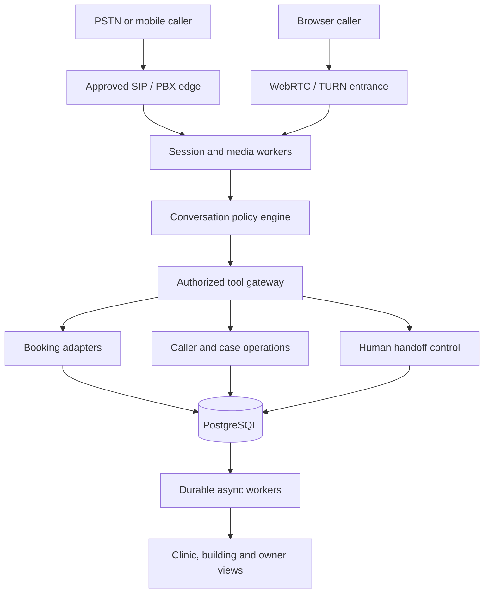

# Persian Voice AI Receptionist
## Revised Product, Architecture, Implementation, and Operating Blueprint

**Edition:** 23 October 2026 — implementation revision 2 / application 0.2.0  
**Scope:** Iran-first, Persian-first AI telephone and browser receptionist for appointment-driven businesses  
**Primary markets:** dental and aesthetic clinics, specialty practices, beauty salons, medical buildings, and appointment-platform partners  
**Decision standard:** evidence-led; specific enough to implement, test, operate, price, and sell  

> **Core proposition.** Build an administrative voice agent that reliably captures missed and after-hours demand, completes verified appointments, coordinates confirmations and cancellations, and hands complicated conversations to a person. Initially sell measurable revenue recovery and staff relief. Build a shared medical-building reception hub once the single-location workflow is reliable. Consider a licensable Persian voice infrastructure product only after real demand, lawful data rights, and model-quality advantages have been demonstrated.

### Revision and delivery contract

This edition preserves the supplied strategy and all of its distinct product, technical, commercial, research and operating directions, while making the implementation requirements more precise. It adds a concrete application architecture, transaction and privacy invariants, capability-based integration boundaries, phase accounting, and evidence rules in §25. It also corrects time-sensitive vendor claims, weak authorization pseudocode, and the provenance language inherited from an earlier eleven-document consolidation.

The companion `requirements.json` is the item-level execution register. `launch-playbook.md` contains concrete discovery, onboarding, supplier, pilot, incident, staffing, economics, and research worksheets. Software readiness, external integration readiness, and business/clinical/contractual readiness must be reported separately. A code package or simulation is not evidence that real telephone calls, settlements, clinic pilots, trained speech models, or commercial agreements have been completed.

**Input provenance:** one supplied consolidated Markdown blueprint was available for this revision. The eleven-file history in Appendix C is the supplied document's provenance claim, not a claim that eleven original files were independently re-inspected in this execution. Source SHA-256: `d056b2893f32f81d6076f3be6d76ce0ca707284d8b8984d968ef8f47270943ef`.

### How to read this blueprint

This document is a unified decision and execution artifact, not a transcript of earlier brainstorming. It distinguishes **capabilities reported by the source research**, **engineering recommendations**, **illustrative business assumptions**, and **claims requiring fresh diligence**. Vendor availability, pricing, model language coverage, legal interpretation and service terms carried over from the source have not been independently reverified by this document revision; their citations are research pointers and dated source claims, not current deployment approval. Illustrative numbers are not forecasts. Named vendors are candidates until Iran availability, contractual access, technical fit, licensing, and commercial terms have been confirmed in writing. All sample clinic identities, prices, addresses, and dates are fictional demonstration data.

### Revision 2 delivery decisions

The 0.2.0 implementation extends the retained blueprint with a complete staff product surface and native distribution projects. Desktop navigation separates daily reception work from administration; the mobile companion prioritizes Today, Tasks, Calls and More. Both use the same server-side roles, appointment authority and operational records. Windows packaging produces an assisted installer and portable executable; Android packaging produces APKs and an app bundle. The companions securely store server-bound staff sessions and require a compatible clinic API. They do not embed a patient database, promise offline mutations, or depend on an open mobile app for server jobs.

The implementation also closes concrete gaps in approved catalog facts and service rules, package/series scheduling, DID routing, external-calendar reconciliation, signed SMS continuation, provider capability/health truth, monetary reservations and vendor reconciliation, purpose/processor policies, protected-artifact retention, on-call work and research workflow tooling. A transactional `0001` to `0002` migration preserves the original deployment and protects legacy billing notes. Exact evidence and any partially met acceptance remain in `requirements.json` and `IMPLEMENTATION_REPORT.md`; this paragraph is not a blanket completion assertion for every research or commercial direction below.

The final implementation review adds privacy-minimized per-tool timing and outcome records, including distinct dispatch and rollback states, and an offline independent-teacher comparison and human-adjudication validator. These close software omissions in the observability and labeling workflow. They do not establish physical-receiver speech latency, actual teacher independence, lawful corpus access, completed human listening or improved model accuracy.

The release workflows first verify the server and shared interface, then build Windows and Android packages from that interface artifact. Optional publisher signing and a draft GitHub Release require the organization's repository and signing material. No repository run, publisher certificate, live carrier, supplier permission, customer pilot, training corpus or model-quality result is invented to fill the real-world completion column.

## Executive decision record

| Question | Consolidated decision | Qualification / gate |
|---|---|---|
| What business are we building? | Vertical AI reception, scheduling, and follow-up SaaS; human-in-the-loop by design. | Do not promise clinical diagnosis, universal automation, or elimination of front-desk staff. |
| Who comes first? | Appointment-dependent dental, aesthetics/laser, and selected high-volume salons; test specialty clinics in parallel. | Select on observed missed-call rate, value per kept appointment, scheduling complexity, and willingness to pay. |
| What is the differentiated expansion? | Shared multi-physician-building hub with doctor-specific routing, a centralized coordinator, and verified warm handoffs. | Start with a cluster of willing doctors rather than assuming building management controls every physician's telephony. |
| What is the first deliverable? | Browser microphone/WebRTC proof of concept with actual deterministic booking, SMS confirmation, and a staffed fallback. | A browser demo can be built quickly; it does not prove PSTN readiness. |
| What runs on the phone network? | Domestic SIP/PBX media edge plus stateful real-time agent sessions, with provider-neutral AI services. | Decide Asterisk AudioSocket retrofit versus LiveKit SIP by carrier/PBX compatibility and measured load. |
| How do bookings remain correct? | Policy-bound scheduling service with live availability checks, slot holds where supported, idempotent commits, and source-of-truth verification. | Prompt-only booking is unacceptable. No confirmed appointment before authoritative write succeeds. |
| How do we control cost? | Provider abstraction, usage budgets, token/audio metering, short conversations, cached authorized prompts, and locally synthesized common phrases. | No assumption that any specific architecture always costs 80–90% less. |
| What is the data strategy? | Product analytics first; consent-separated, purpose-limited training corpus only where lawful and contractually authorized. | Recording notice alone is not a blanket license for training, sale, or international transfer. |
| What counts as launch success? | Verified bookings and recovered demand with acceptable caller experience, safety, data practices, margin, and human override. | Measure against a baseline rather than repeating global marketing percentages. |

### Founding insight, refined

The original discussion developed two linked opportunities: **a centralized hybrid receptionist shared by multiple medical offices** and **a long-run asset in real-world Persian conversational speech**. These are complementary, but should not be conflated. The reception business must stand on its own without speculative revenue from datasets or model licensing. A recording corpus becomes valuable only if collection is authorized, transcription quality is assessed, sensitive audio is appropriately treated, model-rights are defensible, and downstream performance improves on held-out telephone calls.

### Critical misconceptions removed

- **Three days is plausible for a constrained browser demonstration, not a production Iranian telephone service.** Carrier provisioning, SIP/RTP, routing, telecom access, fraud controls, real-time turn taking, reliable scheduling, and operational support require separate validation.
- **Cloudflare Workers are not a drop-in replacement for a SIP/RTP media gateway.** They may host a landing page, webhooks, and selected control-plane services; long-lived real-time browser transport requires an appropriate WebRTC/WebSocket architecture, and raw carrier RTP/UDP termination belongs in a compatible media service.
- **A model is not a calendar, identity authority, or clinician.** The model interprets requests; validated application code owns dates, patient verification, appointment policy, and writes.
- **Fast or cheap foreign APIs are not automatically legal, reachable, or available from Iran.** Vendor terms, geographic availability, cross-border processing, reliability, and payment access are commercial gates, not networking inconveniences to bypass.
- **A shared coordinator is not automatically one person for 40 clinics.** Staffing must follow observed escalation volume, call-time distributions, hours of coverage, and acceptable queue time.
- **A recorded patient call is not automatically training data.** Administrative service processing, optional recording, quality assurance, model training, and sale to third parties are different purposes with different permissions.

## 1. Problem definition and customer jobs

### 1.1 Current operations

Receptionists simultaneously welcome visitors, handle payments, identify patients, explain practice rules, answer calls, administer insurer workflows, and reconcile appointment books. Peaks coincide with in-person arrival windows, shift changes, lunch hours, high-demand procedure campaigns, and business closure. An unanswered or abandoned call may represent an appointment, a cancellation, a simple address question, or an urgent request. **Do not equate all missed calls with lost revenue.**

Patients want an understandable Persian conversation, the correct doctor/service, a suitable real slot, accurate price/location/preparation information, confirmation on their phone, and a person when they need one. The physician wants a clean schedule and fewer interruptions; the existing secretary wants less routine phone work without losing control. The building manager wants consistent routing across units but cannot necessarily act as the legal or administrative controller of every independent clinic.

### 1.2 Jobs to be done

| Caller | Clinic receptionist / coordinator | Owner / doctor |
|---|---|---|
| Ask working hours, location, parking, accepted insurance, and approved preparation instructions. | See current AI conversations and take over a call. | Recover otherwise unanswered calls and reduce idle capacity. |
| Book, move, confirm, or cancel an appointment without repeating information. | Review pending exceptions and approve complex bookings. | Protect staff time and avoid introducing duplicate or unsafe bookings. |
| Request the correct specialist, book for relatives, and clarify date/time in Shamsi Persian. | Correct a transcript, patient match, or provider selection. | Monitor outcomes, consumption, and complaints in one simple view. |
| Receive accessible SMS or alternative confirmation and reach a human on demand. | Reconcile late changes and stale online availability. | Preserve brand trust, patient privacy, and control over operational rules. |

### 1.3 Value mechanisms to measure separately

1. **Call capture:** answered incremental calls versus comparable pre-pilot windows, disaggregated into new leads, existing patients, FAQs, and errors.
2. **Booking conversion:** calls with verified appointment commitments, not merely a verbal claim or a calendar page opened.
3. **Attendance protection:** incremental kept visits, not simply reminders sent or cancellations detected.
4. **Staff capacity:** time saved on routine inquiries net of exceptions, corrections, training, and supervision.
5. **Customer experience:** transfer quality, callback rate, repetition, response speed, ASR accuracy, and complaint rate.
6. **Revenue recovery:** *incremental kept appointments × contribution margin*, net of displacement, refunds, telecom, payroll, support, and model expense.

International marketing benchmarks in the inputs cite 20–42% missed calls, 40–41% after-hours activity, 62–85% abandonment or non-callback, 67% competitor redirection, $125–$200 missed-visit values, and 8–34× ROI. They are **hypotheses and external-context figures**, not proven Iranian averages. Require original study definitions and domestic pilot data before using them in a commercial guarantee.

## 2. Target market and entry strategy

### 2.1 Ideal-customer-profile matrix

| Segment | Why the product might pay for itself | Complexity and proposed entry |
|---|---|---|
| Aesthetic/laser/dermatology, dental and dental surgery | Appointment-specific equipment or specialist time; Instagram campaigns; deposits and follow-up matter. | **First paid pilot candidate.** Price accuracy, treatment-specific durations, prep policy, and no-show workflows must be explicit. |
| Beauty and bridal salons | Stylists cannot always answer the phone, services have variable lengths, cancellation slots are hard to backfill. | **First demo / low-risk booking pilot.** Strong WebRTC-in-bio use case; lower clinical-data exposure, though consumer privacy still applies. |
| Physiotherapy, imaging, diagnostic, orthopedics, psychology, selected specialty offices | Scheduling friction and high-value missed slots. | **Selective expansion.** Equipment, referral, privacy, complex prep, and specialist routing make configuration more complex. |
| Multi-doctor clinics and medical buildings | Concurrent demand, fragmented numbers, multiple calendars, and coordinator handoffs. | **Second-stage strategic wedge.** Requires tenant isolation and staff workflow, not a simple IVR skin. |
| General practices with substantial walk-ins | High call demand does not necessarily translate to incremental bookings. | **Deprioritize unless pilots show paid demand.** More price-sensitive and may depend on physical reception. |
| Medical booking platforms and practice-management software | Distribution, existing appointment source of truth, channel expansion. | **Partner later; approach early for technical discovery.** Access may be restricted, and commercial cooperation is not assumed. |
| Hospitals, banks, insurers, large contact centers | Sovereign deployment and Persian speech operations could eventually matter. | **Long-term enterprise infrastructure option**, distinct from clinic SaaS and with much higher compliance/support cost. |

Do not assume a famous, fully booked doctor has no reason to answer calls: referral continuity, complaints, safety, access and patient experience may still have value. Conversely, higher visit fees do not guarantee willingness to buy. Rank pilots on *observed* economics and change-management readiness.

### 2.2 Wedge selection scorecard

Score each prospective pilot 0–5 on weekly missed/abandoned call volume, actual available appointment capacity, contribution margin per filled slot, management commitment, scheduling API access, telecom forwarding control, staff collaboration, complexity/sensitivity, and willingness to pay. Choose the first segment with the shortest path to independently verifiable kept appointments, not the most impressive demo audience.

**Suggested order:** (A) two independent dental/aesthetic/beauty locations; (B) one five-clinic or smaller building cluster; (C) multi-building operations; (D) booking-platform partnership; (E) optional Persian voice APIs. This reconciles documents alternately calling salons, solo specialty clinics, or medical buildings the first target: **pilot low-complexity sites, make the building hub the differentiator, and partner only after proof of integration quality.**

## 3. Competition and positioning

### 3.1 Competitive landscape

| Provider / category | Input-document observations | How to respond |
|---|---|---|
| **Poshtyar (پشتیار)** | Persian AI reception; 021 number, SIP/PBX and Issabel connections; call tools, texts, booking and voice choices. The supplied October 2026 research reports annual 9.9M / 18.9M / 28.9M Tomans, one-time annual gifts of 700 / 1,500 / 2,500 minutes, 5,000 Tomans per excess minute, and a stated 10% VAT exclusion. These are historical comparison inputs requiring a fresh quote. [S1] | Compete on *cost per verified booking*, transparency at high usage, after-hours conversion, clinic-native integrations, live human control, and measured accuracy. Do not compete merely on saying “24/7 AI”. |
| **Peno AI** | Source reports mention tailored agents, tool use, business-system connectivity, and custom consulting. | Validate product and pricing directly; treat as a possible bespoke enterprise competitor. |
| **Amer Andish (FarsAva / Hooshtel)** | Reported Persian STT/TTS and call-center infrastructure; possible on-prem speech partner. | Run side-by-side benchmarks and request security, licensing, latency, and pricing terms. |
| **Asr Gooyesh Pardaz (DanaBot / Ariana / Shiva)** | Reported voice bot, Persian TTS and noise processing components. | Candidate component supplier; verify exact current product availability. |
| **Avanak / Avaxel** | Automated outbound voice workflows and bulk calling noted in sources. | Potential reminder delivery partner, but check opt-in, charging, policies, and measured connection rates. |
| **Sitak / Workano / Issabel PBX providers** | Existing telephone menus, PBX routing, recording, and sometimes AI-QC capabilities. | Integrate instead of requiring a PBX replacement; white-label and referral distribution may be attractive. |
| **Paziresh24, Doctoreto, Nobat.ir, Boghrat, Medario, Darman Doctor, GR Software** | Scheduling, medical administration, and appointment marketplaces in the source materials. | Mostly integration targets or indirect substitutes, not necessarily voice-agent direct competitors. Confirm write API access and permission. |
| **International Vapi / Retell / Bland / Synthflow / Anservo** | Sources discuss voice infrastructure, orchestration, and Western medical examples. | Reference patterns and pricing structures; do not assume Iranian phone-number support, lawful data flow, or competitive economics. |

The source blueprint states that its Poshtyar values were cross-checked against a public tariff page. This revision retains the figures as a dated research snapshot; it has not reverified the tariff, advertised performance, delivered quality or sustained availability. Many other source-reported feature lists, market-share figures, advertised doctor counts, and third-party prices were not independently substantiated. The documents inconsistently report Poshtyar ranges as high as 49.9M/year and excess rates to 8,000 Tomans; **retain each figure with its original retrieval context and obtain a new written quote before a commercial comparison**. [S1]

### 3.2 Positioning that can be defended

**For owners:** “We help you answer appointment demand you currently miss; every confirmed action is reflected in your real schedule; people stay in control.”  
**For receptionists:** “We handle routine calls, highlight exceptions, and pass the caller and context to you when needed.”  
**For patients:** “Talk naturally in Persian, confirm the exact day/time, receive a message, and ask for a person at any point.”  
**For platform partners:** “A permissioned voice channel over your booking system rather than a competing calendar silo.”

## 4. Product portfolio and release boundaries

### 4.1 Product surfaces

- **Clinic Voice Receptionist:** configurable inbound and after-hours/overflow answering; doctor-specific FAQs; live booking/move/cancel; SMS; escalation; clinic manager console.
- **Shared Medical-Building Hub:** several independent clinic tenants, routing by telephone number/name/specialty, per-clinic policy and calendar adapters, central exception queue, human coordinator, usage allocation and audit controls.
- **Web Voice Link / Widget:** mobile browser “Talk to reception” URL in an Instagram bio, on a website, QR code, or printed card; permissioned microphone session using WebRTC over a proper live media endpoint. No SIP leg is needed, but WebRTC connectivity, TURN, consent and mobile browser behavior still require testing.
- **Retention and Capacity Engine:** opt-in appointment reminders, rescheduling, cancellation recovery, waitlist offers, deposit links, and approved post-visit follow-up.
- **Integration/API and White Label:** partner adapters and agency distribution after initial pilot; optional enterprise Persian voice platform at a much later stage.

### 4.2 Features prioritized without losing the longer horizon

| Capability | MVP / pilot | Later only after gates |
|---|---|---|
| Answer inbound calls, hours/address/parking FAQs, short conversational Persian, one question at a time | Required | Rich multi-lingual switching and personalized voice styles |
| Live slot lookup, visit/service choice, create/modify/cancel and read-back confirmation | Required | Complex multi-resource bundles, procedures, recurring scheduling |
| Human request, sensitive-symptom safeguards, queue and handoff | Required | Multi-agent specialty workflows and staffing forecast |
| SMS delivery status, reminder opt-in, accurate appointment details | Required | Voice campaign orchestration and multi-channel messaging |
| One provider/one calendar integration and trustworthy appointment event log | Required | Paziresh24 / Doctoreto / ERP / EHR partner breadth |
| Browser talk link and straightforward clinic panel | Required for browser pilot | Branding kit, Instagram/Telegram voice-note channels and PWA |
| Tenant separation, scopes, consumption metering, issue review | Required foundation | Building supervisor pools, white-label agency accounts |
| Cancellations and waitlist offers | Small controlled pilot | Fair optimization across branches and providers |
| Deposit reservation and gateway webhook | Optional early salon pilot | Refund policy automation, installments, dynamic pricing |
| Caller memory, next-visit offers, post-care and family booking | Explicitly opt-in, not default | Multi-person booking and clinically approved intake rules |
| Speech-model fine-tuning / realtime voice API | No | Dataset-evidence and explicit-rights gated phase |

### 4.3 Non-goals and prohibited product behavior

No independent medical diagnosis, prescription, severity classification that substitutes for staff, claim that patients are guaranteed a slot without verified calendar mutation, unsupported insurance-coverage commitments, undisclosed voice cloning, automatic recognition of a caller solely from Caller ID for sensitive information, covert staff-call interception, silent secondary training use, or blanket “free unlimited SMS/minutes” marketing.

## 5. Principal user journeys and state machines

### 5.1 Inbound caller journey

**RINGING → CONNECTED → NOTICE/CHOICE → IDENTIFY_TENANT → INTENT → EXTRACT_FIELDS → VALIDATE → LOOKUP → OFFER → HOLD/CONFIRM → COMMIT → VERIFY → ACKNOWLEDGE → NOTIFY → COMPLETE.**

At each conversational state, the system may take the **HUMAN_REQUEST**, **URGENT_HELP**, **LOW_CONFIDENCE**, **TECHNICAL_FAILURE**, **CALL_DROPPED**, or **TIMEOUT** transition. Fallbacks must be operational, not merely a promise from the language model. Two failed attempts at a critical number/date should trigger an alternate route (DTMF, SMS verification, live transfer or call-back request). Make timeout thresholds configurable for slower speech, older callers, and poor mobile connections.

A normal exchange uses concise, natural Persian:

> Agent: «سلام، شما با دستیار هوشمند پذیرش کلینیک تماس گرفتید. بفرمایید، برای چه کاری تماس گرفتید؟»  
> Caller: «برای مامانم سه‌شنبه هفته دیگه وقت می‌خوام.»  
> Agent: «حتماً. برای کدوم پزشک یا خدمت می‌خواستید؟»  
> [Calendar resolver disambiguates next Tuesday; authoritative API returns two slots.]  
> Agent: «سه‌شنبه، ساعت چهار و نیم یا شش خالیه. کدوم مناسب‌تره؟»  
> Caller: «شیش.»  
> Agent: «به نام ایشون و با تایید شماره تماس، این وقت رو ثبت کنم؟»  
> [Booking service validates and commits.]  
> Agent: «نوبت ثبت شد. پیامک تایید با تاریخ و ساعت براتون ارسال می‌کنیم.»

**Important:** The exact announcement must follow the approved consent design. If recording is off or refused, the agent must accurately describe the processing that still occurs, and present available alternatives. The example does not assert a particular legal formula.

### 5.2 Human-in-the-loop model

**Autonomous path:** routine permitted booking, cancellation, or verified FAQ.  
**AI captures, staff confirms:** insurance ambiguity, procedure requiring special duration, missing patient record, inconclusive schedule, or patient preference requiring review. AI gathers minimal context and creates a structured staff task; it does **not** claim a final booking.  
**Live human transfer:** explicit request, repeated confusion, distress, possible acute symptoms, privacy concern, complaint, billing dispute, or tool failure where waiting is unacceptable.

A **warm transfer** is more than a SIP REFER: the coordinator sees a call card with tenant, purpose, consent state, relevant verified fields, failed attempts, pending actions, and a minimal handoff summary. The agent must not expose one doctor's patients to another doctor's receptionist or to an unauthorized building-wide monitor. If the human fails to answer, offer safe callback capture or a route to the clinic's existing line; never trap callers in infinite holds.

### 5.3 Urgency and medical safety

The agent is an **administrative scheduler**, not a diagnostic triage system. Approved phrase/intent policies may detect potentially urgent descriptions and stop ordinary booking to advise using local emergency services when appropriate and connect available authorized staff. Do not determine clinical severity, suggest doses, or provide time-critical treatment advice. For an emergency, the system must not delay caller access behind model tool calls. Content and escalation scripts require review by a qualified clinical adviser before any medical launch.

### 5.4 Same day, family and disruptions

Support a parent or sibling booking for another person only after collecting the correct patient's identity and consent/authorization where relevant. For two-person booking, separate holds/transactions and acknowledgements for each. If a caller is stuck in traffic, offer valid later slots without falsely extending an existing reservation. Differentiate patient cancellation from provider-initiated postponement; preserve original appointment ID and complete audit trail.

## 6. System architecture and hosting choices

### 6.1 Canonical topology



This diagram describes the logical integration boundaries. The media layer owns turn detection, interruption and the selected speech contracts; the policy and tool layers enforce tenant scope, authorization and validation. Booking adapters use the declared calendar authority. Case operations cover consent, notifications, financial evidence and the outbox. Handoff control requires real transport evidence before reporting a human connection. Durable workers handle eligible reminders, waitlists, reconciliation, digests and reporting. Optional object storage or Redis must not replace PostgreSQL's final authority for committed business state. Named vendor adapters, native speech streaming and complete carrier transfer events remain subject to the specific implementation and approval gates in the requirement register.

`*` The public existence of a booking provider or API repository does not establish the write permissions needed by this product. Test with a sandbox and signed provider authorization.

**Plane separation:** media is stateful and latency-sensitive; deterministic booking is transactional; messaging and reminders are event-driven; analytics and lawful dataset processing are asynchronous. Store immutable booking outcome facts separately from speculative model dialogue. A CDN/Cloudflare page, webhook, or queue is useful but must not be mistaken for the telephone media endpoint.

### 6.2 Deployment variants and selection

| Variant | Best fit | Trade-off / decision |
|---|---|---|
| **Asterisk / Issabel + AudioSocket sidecar** | Clinics already using Asterisk, low-cost domestic SIP proof, simple local media tap | Must implement PCM handling, turn state, cancellation and bridging; verify installed modules and supported versions. Primary retrofit candidate. |
| **LiveKit Server + SIP bridge + Agents** | Greenfield web-and-phone product, richer WebRTC, multi-party transfers, building-wide routing | More moving parts (media server, SIP, Redis, agent workers, TURN/network configuration); test domestic hosting and codec negotiation. Primary SaaS-scale candidate. |
| **Pipecat session inside compatible transport** | Explicit modular VAD/STT/LLM/TTS, cross-provider flexibility | Orchestrator rather than carrier replacement; still needs appropriate SIP/WebRTC entry. |
| **Bolna / Vocode / Jambonz / AVR / other complete agents** | Reference or alternative if maturity, license, connectivity, and operational cost fit | Avoid absorbing overlapping frameworks into an unmaintainable product. Evaluate with one adapter spike. |
| **AGI/EAGI-only blocking scripts or raw custom ARI/RTP from scratch** | Narrow legacy maintenance or specialized integration | Not first choice for responsive interruption-heavy telephone agent without strong telecom engineering. |

**Recommendation:** Keep a **transport abstraction** around `start_call`, `send_audio`, `interrupt`, `transfer`, `hangup`, and call events. Begin with one validated Asterisk retrofit or one LiveKit route—not both in parallel. Build an integration conformance suite so the second can be added without rewriting booking and privacy logic.

### 6.3 Iran connectivity constraints

Terminate carrier SIP signaling and RTP at a **permitted, reachable domestic endpoint** when an Iranian number/provider requires it. Request a documented carrier interconnect specification: static-IP requirements, PJSIP registration or IP-peering, available DIDs, offered channels, outbound caller ID, codecs, DTMF mode, ACLs, TLS/SRTP availability, forwarding/overflow rules, service hours, billing pulses, emergency numbers, and support SLAs. Candidate carriers in source reports include Asiatech, Shatel, TCI, Nexfon and Simutel; none is pre-approved by this blueprint.

Cross-border speech processing is an **option contingent on legal and contractual permission**, not a default design or a suggested bypass of geography controls. Evaluate reachability, tail latency, vendor terms, service availability, and patient-data safeguards from the actual deployment network. Maintain a domestic-processing mode or safe human fallback if required. WebRTC over HTTPS does not guarantee the stream bypasses local connectivity restrictions, and a browser widget needs TURN and mobile-device trials.

## 7. Telephony and media engineering specification

### 7.1 What runs on the wire

SIP negotiates and controls calls (INVITE, 200 OK, ACK, BYE), while RTP typically carries continuous media separately. Carrier calls commonly use 8-kHz G.711 A-law / mu-law. On a 20-ms frame, a mono G.711 payload has 160 samples/bytes; mono signed 16-bit PCM at 8 kHz occupies **320 audio bytes** per 20 ms. Different transports and resampling stages must not conflate encoded G.711 bytes with linear PCM bytes.

Asterisk AudioSocket is a documented TCP framing protocol with a 1-byte type, 2-byte big-endian payload length and a variable-length payload. Its documented 0x10 audio type is **signed linear 16-bit 8-kHz mono little-endian PCM**, while other packet types indicate 12/16/24/32/44.1/48/96/192-kHz PCM and DTMF. The AudioSocket dialplan application, available since Asterisk 18, transmits 8-kHz signed linear audio unless using channel-driver capabilities; it does **not** natively mean “stream raw mu-law bytes to the socket.” [S2]

### 7.2 Required integration tests

- **Call setup/teardown:** inbound and outbound, caller ID, hangup race, timeout, failed transfer, no-answer, hold music and billing end.
- **Audio:** A-law/u-law negotiation, resampler correctness, 20-ms pacing, RTP jitter, silence detection, playback queue flush, DTMF `0–9`, `*`, `#`, mono caller audio and separate agent emission, packet-loss recovery and wrong-codec detection.
- **Network:** symmetric NAT, one-way audio, IP ACL, private endpoint reachability, changing carrier SBC IPs, UDP port binding, TURN for web, domestic mobile-operator differences, and loss of international dependency.
- **Conversational:** barge-in while TTS plays, false triggers from traffic/background speech, rapid digits, long hesitant turns, interrupted read-back, and disconnected tool calls.
- **Operations:** 4–8 concurrent pilot-channel tests, then stepwise 10/20/50/80 simulated sessions where carrier contracts and infrastructure permit. Do not promise concurrency without load testing each layer.

Potential failure modes collected from earlier reports—AudioSocket application CPU spin in certain builds, missing Opus codec with Asterisk-to-WebRTC bridging, frame-buffer overruns, and Docker-host UDP port exposure—are **reproducible test hypotheses**, not universal truths. Choose a supported Asterisk release, inspect `module show like audiosocket` and codec status, review version-specific bug fixes, and use measured packet captures. Docker host networking is sometimes convenient for SIP/RTP but is not universally mandatory and requires deliberate firewall isolation.

### 7.3 Latency budgets and barge-in

Define turn latency as `first audible output - detected end of caller's turn` and separately measure `STT first partial`, `STT final`, `LLM first token`, `tool round-trip`, `TTS first audio`, `playback underrun`, and `human pickup`. A stretch target is **median ≤ 0.8 seconds** for simple turns and **p95 ≤ 2.0 seconds** under representative Iranian PSTN conditions; these are *engineering gates to validate*, not measured product promises. Longer live booking-tool pauses must have clear, honest feedback and an escape route.

State-dependent endpointing: allow a longer response window for spoken telephone numbers and older/slower callers; detect new caller speech during playback; cancel uncommitted generation and clear queued TTS. Interruption must never undo a committed booking or start a second booking without idempotency. Cache greetings and approved transition phrases locally as audio, but do not mask outages with looping filler. Fabricated typing/office ambience can feel deceptive; prefer one genuine acknowledgment, call-progress feedback, and fallback after a deadline.

### 7.4 Concurrency and capacity

Track inbound Offered Calls, Answered, Rejected (carrier channels), Concurrent Sessions, CPU/GPU saturation, memory per session, trunk limits, outbound channel occupancy, and escalation staffing. Use empirical arrival distributions and service times (including simultaneous call bursts), not merely monthly minutes. Ringing and failed calls are part of caller experience. Provision queue thresholds, human transfer overflow, per-tenant quotas, and admission controls. Rehearse failure of the primary carrier, media server, speech provider, database, and message gateway.

## 8. Speech, language, and conversational intelligence

### 8.1 Compare architectures rather than select by branding

| Mode | Strengths | Risks, measurement and place in product |
|---|---|---|
| End-to-end speech-to-speech / realtime model | Prosody, interruption, a single audio interface, rapid web demonstration | Runtime-priced audio tokens/seconds, opaque recognition errors, limited deterministic domain control, changing model families and terms. Useful benchmark and optional premium path, not assumed cheapest. |
| Cascaded streaming VAD → STT → text LLM → TTS | Component choice, inspectable transcript, Persian term injection, caching, local substitution, explicit control of policy and costs | Requires tuning turn detection, text/voice synchronization, latency at each boundary and coherent prosody. Preferred baseline for high-volume cost experiments. |
| Hybrid / local-first | Domestic audio and optional local STT/TTS/LLM; resilience and control | Hardware amortization, GPU throughput, model adaptation, maintenance, licenses, voice quality. Enable only when the measured total cost/performance wins. |

The material discusses OpenAI Realtime, Gemini Live, ElevenLabs realtime, `gpt-4o-mini`, GPT-realtime-mini, Groq, Soniox, and local speech-to-speech. These are *candidate families*, not a fixed dependency set. The source research describes model-dependent audio/token and session accounting rather than a single universal “$0.30/minute” constant; validate the exact billing categories in current first-party documentation and the selected account contract; calculate costs using actual input/output tokens and live seconds for the selected SKU. [S3]

### 8.2 Speech-to-text candidates

| Candidate | Relevant source detail | Due diligence |
|---|---|---|
| **Deepgram Nova-3 Persian (`language=fa`)** | The source research reports an official Persian streaming/batch option and Keyterm Prompting for domain vocabulary; verify the selected model, endpoint and account before integration. [S4] | Measure 8-kHz mobile audio, conversational Persian, names, digits, partial/final timing, missing first words, geographic processing and cost. |
| **Soniox STT** | The supplied research records streaming around **$0.12 per audio hour** and async around **$0.10/hour** at retrieval time; these are unrefreshed comparison inputs; the source reports emphasize multi-language low-latency recognition. [S5] | Run legal/availability check, true Persian telephone WER/CER, diarization and streaming API stability. |
| **FarsAva / domestic STT** | Reported domestic Persian and dialect specialization and local deployment possibilities. | Direct technical demo, written quote, model-hosting location, API throughput, export/retention terms. |
| **Groq Whisper-large-v3-turbo, Faster-Whisper and smaller Persian-tuned Whisper** | Potential low-cost batch or streaming-like chunked paths and local fine-tuning. | Whisper-family chunked decoding is not inherently equivalent to low-latency continuous ASR. Test hallucination on silence and short phrases. |
| **ElevenLabs Scribe, Gemini Flash, OpenAI transcription, other providers** | Alternative and teacher-transcription services. | Confirm exact Persian language support, domain accuracy, stable pricing and contractual availability before recommending. |

**Benchmark corpus:** at minimum collect authorized and separately held-out anonymized samples stratified by Tehran colloquial speech, Isfahani/Shirazi/Mashhadi/Yazdi accents, Azeri-accented Persian, code-switching, Gilaki/Kurdish-accented Persian where consented, female/male/elderly callers, low-cost handset, G.711 codecs, clinic noise, traffic, false starts and pauses. Measure exact mobile/National ID digit accuracy separately from WER/CER; a low generic WER can still produce disastrous wrong appointments. All benchmark collection requires privacy and authorization controls.

The report's assorted percentages (e.g., generic Persian 8% WER vs 24% vs 100%, or a specific model “21× smaller and superior”) are **not directly comparable** without identical samples, normalizers, decoding and metrics. Treat model ranking as an experiment, not a fact. Likewise “Deepgram 300 ms” is not an end-to-end phone-call latency guarantee.

### 8.3 Conversation model and guardrails

Use a short, policy-bound agent with a clear **explicit conversational state**, typed tool interfaces, retrieved verified facts, and no hidden calendar side effects. Prompts specify the role and style; code enforces critical actions. Ask one question at a time, never present Markdown to spoken TTS, and limit routine answers to one or two sentences unless clarity requires more. The model may paraphrase *approved* facts about working hours, parking, address, service prices, insurance, and procedure preparation, but must not improvise clinic policy. Changes to prices/coverage should enter the configuration with owner approval and versioned publication time.

Every model response should carry metadata outside speech text: `conversation_id`, `intent`, `confidence/signals`, `pending_tool`, `policy_version`, `verified_fields`, `proposed_spoken_text`, and `handoff_reason` when applicable. Never render internal JSON, an API error, or patient-sensitive operational details to the caller.

### 8.4 Speech generation and voice quality

Evaluate **ElevenLabs**, **Cartesia Sonic**, **Azure fa-IR voices**, **Ariana**, and local **Piper Persian** or **Pocket-TTS Farsi** against the same scripts. The source research points to Piper voice-list entries for `fa_IR`, including `amir`, `ganji`, and `gyro`, but each *voice-model license* and suitability for commercial deployment must be checked independently; older Piper repositories and community forks may have different code licenses. [S6]

Persian pronunciation risks include **ezafe / کسره**, homographs, formal-to-colloquial variation, provider names, Tehran streets, Arabic or English medical words, Shamsi months, and numeric formatting. A pronunciation dictionary with versioned phonetic alternatives is safer than forcing the LLM to add diacritics to every token. Deterministically verbalize times, dates, prices, and identifiers before TTS; QA the output in real telephone narrowband. For sensitive numeric fields, audio read-back alone is weaker than callback OTP or a signed confirmation link.

Pre-render stable phrases such as «سلام، وقتتون بخیر»، «یک لحظه، وقت‌های خالی رو بررسی می‌کنم»، and transfer acknowledgments in a licensed voice. Avoid claiming that cached content will make “80% of all speech free”: actual hit ratio depends on diversity, service-specific facts, and whether a dynamic segment can be safely assembled without mispronunciation. Record and monitor cache-hit rate and playback-quality artifacts.

### 8.5 Language, accessibility, and human-factors support

Start with polite, natural Persian; optionally recognize English/Arabic code-switching and route bilingual calls to an approved human or language-specific model. Do not promise effortless Arabic/English coverage because multilingual medical tourism is only a market hypothesis. Caller fatigue and cognitive load matter: repeated failures, overlong instructions, and a fake “empathetic” persona can damage trust. The UI and spoken prompts should accommodate older patients, hearing difficulty, low-bandwidth calls, and disabilities. Offer DTMF, replay, slower speech, SMS, and human support as alternate input/output channels.

**Emotion detection:** distress-aware pacing and escalation can be useful; avoid storing unsupported psychiatric or emotional inferences. “Voiceprint fraud detection” is sensitive biometric processing and should not be enabled merely to suppress prank calls. Prefer transparent rate limits, OTP controls, and booking quotas.

## 9. Calendar, time, numbers, and Iranian locale correctness

### 9.1 Fundamental rule

**LLMs may describe a date but must not be the authoritative calculator.** Keep the transaction time in a consistent timestamp representation (e.g., UTC instant plus `Asia/Tehran` timezone, provider-local service date, duration, and calendar version). Convert to Jalali only with a tested library/rules; re-check the displayed day of week and ensure no negative or ambiguous time offset is silently accepted. Iran locale conventions, weekend days, holiday shifts, and changing provider hours are business-policy inputs.

A rolling **14-day Shamsi context** may improve dialogue for near-term requests, but it is a comprehension aid, not a proof of correctness. For “سه‌شنبه هفته دیگه”, “پس‌فردا نزدیک غروب”, “بیستم آبان”, “پنجشنبه صبح”, “اولین وقت”, and “هفته آینده”, pass the **raw utterance** to a deterministic resolver with a frozen call-time reference. Return one or more ISO Gregorian instants and Jalali human display labels **plus an ambiguity flag**. Explicitly confirm the intended exact date whenever relative “next” conventions differ or ambiguity remains.

### 9.2 Locale acceptance cases

| Spoken request | Required implementation response |
|---|---|
| «فردا ساعت چهار و نیم» | Resolve tomorrow in Tehran local time; interpret 4:30 using clinic shift context, clarify AM/PM if ambiguous. |
| «سه‌شنبه هفته دیگه» | Resolve or ask whether it means the immediately upcoming or the following week's Tuesday; speak the full Jalali date. |
| «بیستم آبان» | Determine intended year from policy/window, not from LLM assumption; reject dates before permitted booking horizon. |
| «پس‌فردا غروب» | Query a shift range rather than inventing a specific clock time. |
| «چارشنبه شیش و نیم» | Normalize colloquial pronunciation to Wednesday 18:30 only when context is sufficiently confident. |
| «برای دو نفر» | Create two separate availability holds and verify both patient records and accepted times. |
| Spoken `09...` mobile or 10-digit کد ملی | Normalize Persian/Arabic numerals, verify length/checksum where relevant, confirm aloud or via secure challenge, avoid logging raw strings. |
| Jalali year boundary / leap Esfand / long holiday | Regression test conversion and whether the clinic actually operates on those dates. |

A National ID's modulo-11 checksum tests syntactic validity; it does **not** prove identity or ownership. Collect it only when the actual workflow requires it. Caller-ID numbers may be spoofed, recycled, withheld, or belong to a family member. For cancellations/reschedules that reveal sensitive appointment details, perform an appropriate verification step.

### 9.3 Time and day formatting

Display human examples like «سه‌شنبه، پنجم آبان، ساعت چهار و نیم بعدازظهر», not `1405-08-05 16:30`. Maintain a separate canonical `slot_id` for the real calendar. A database never uses a prose date string as the unique appointment identifier.

**Quality correction to inherited sample code:** one earlier `calendar_context.py` derived Persian weekday names from `jdatetime.weekday()` and a manually enumerated map without documenting the library's weekday convention. Avoid that assumption: compute the weekday from a standard Gregorian `date.weekday()` with an explicitly Monday-first mapping, then compute Jalali calendar fields using a tested converter. Also replace static sample dates from October 2026 with dynamic `Asia/Tehran` reference time. The appendices provide an amended reference implementation.

## 10. Scheduling platform adapters and correctness

### 10.1 Integration principles

Connect to the practice's **authoritative appointment book**: Paziresh24, Doctoreto where permission exists, Cal.com, a salon system, an in-house Postgres calendar, or approved EHR/office software. The source documents also identify Hamdast, Nobat.ir, Boghrat, Medario, Darman Doctor, GR Software, NobatNegar, Nobat Plus, Bookly, and general REST/SOAP/GraphQL/webhooks. A public GitHub API repository for Paziresh24 exists, but its existence does not establish private patient writes, API keys, production scopes, quotas, webhook rights, or platform partnership. [S7]

For every connector, document `auth_type`, token custody, supported list/get/create/cancel/update operations, patient lookup and identity limitations, source-of-truth semantics, timezone, status mapping, webhooks/polling, idempotency, rate limits, retries, financial side effects, and irreversible actions. Prefer official supported APIs. Avoid browser scraping and RPA unless formally authorized, and never claim full record integration merely because public read endpoints exist.

### 10.2 Booking is a transaction, not a sentence

1. Normalize and validate tenant, location, provider, service, patient/callback method, proposed time, required duration, buffer, and restrictions.
2. Fetch live provider availability from source of truth. Consider other resources: rooms, chairs, procedure equipment, break times, floating shifts, clinic holidays, staff availability, prepayment rules, and lead times.
3. Offer at most two valid slots with clearly spoken Jalali date/time. Avoid offering stale cached availability as confirmed.
4. On caller selection, obtain a **temporary hold** where the provider supports one; otherwise submit a conditional create to the authoritative engine.
5. Check action authorization, previous booking changes and fraud/rate limits; use a deterministic **idempotency key** scoped to tenant, session, operation and chosen slot.
6. Commit once, then **read back** returned `external_booking_id`, exact provider/date/service/duration, status, and payment obligations. If commit outcome is unknown, reconcile before repeating; do not create a duplicate.
7. Speak “confirmed” only when authoritative state says it is confirmed. If pending approval, clearly say pending; if SMS fails, booking may remain confirmed, with a separate delivery status.
8. Append audit event; enqueue notification using an outbox and delivery deduplication, then release any unused holds.

### 10.3 Double-booking and consistency strategy

Calendar cache may be stale due to online, secretary, and voice writes occurring concurrently. The source reports correctly identify the **live-read-before-booking / write-then-verify** pattern, but read-then-write alone does *not* guarantee exclusion. Preferred protection is conditional write or unique constraint/serializable transaction in the underlying authority; if the external API has neither, use narrow local holds only for *local* callers, then revalidate/reconcile external conflicts. Treat unconfirmed external writes as pending; never silently create a shadow record. Poll or reconcile external services if no webhooks exist, with recorded lag and conflict alerts.

**Required state examples:** `OFFERED`, `HELD`, `PENDING_PAYMENT`, `PENDING_STAFF_APPROVAL`, `CONFIRMED`, `CANCEL_REQUESTED`, `CANCELED`, `RESCHEDULE_PENDING`, `EXPIRED`, `FAILED_NEEDS_REVIEW`. Every state transition needs explicit responsibility, timestamp, source and authorization.

### 10.4 Service-specific policy, clinic onboarding and insurance

Store tenant-approved catalog entries for doctor, service type, duration, room/equipment, pricing, consultation packages, preparation, cancellation deadline, accepted insurer rules and exceptions. The source gives **10/20/40-minute bronze/silver/gold consultations** as examples, not universal healthcare tiers. Avoid claiming current insurer status from memory. Insurance e-prescription and Tamin Ejtemaei/Salamat portals require dedicated contractual integrations and should not be accessed by scraping. Structured intake notes should be limited to operational facts approved for collection, not full free-form symptom histories by default.

### 10.5 System-of-record boundaries

| Domain | Sole source of truth | Safe cache / derived representation |
|---|---|---|
| Appointment | Provider calendar or approved internal booking database | Search cache, displayed Jalali labels, call offer options |
| Patient identity | Authorized patient/EHR record and verification state | Minimal redacted caller/session fields |
| Current clinic rules | Versioned tenant policy configuration | Read-only in-call snapshot with version/expiry |
| Payment | Licensed gateway + signed webhook and refund ledger | Pending invoice/deposit state; never infer paid from SMS sent |
| Notification | Delivery service status + outbox retries | SMS attempt logs with masked recipients |
| Call and transcript | Telecom session state and consent-governed record store | Redacted QA/analytics records and expiry metadata |

## 11. Privacy-aware application data model

| Entity | Important fields and invariants |
|---|---|
| `Tenant` | tenant_id, legal operator/controller, default region, data-retention plan, settings_version, business hours |
| `ClinicUnit` / `Practitioner` | tenant_id, building_id optional, provider_id, DID routing, schedule adapter credentials reference, room/resource IDs |
| `Service` / `SchedulingRule` | duration, lead-time, cancellation window, buffers, equipment, price disclosure, insurance notes, published version |
| `CallSession` | call_id, tenant_id, channel, telecom leg, consent state, policy version, start/end, failure, transfer, language |
| `CallerContact` / `PatientLink` | encrypted contact fields, verification method/time, minimum required identity, consent scope, deletion state |
| `Appointment` / `SlotHold` | source calendar ID, external_booking_id, slot/timezone, status, service, reference, version, idempotency key |
| `StaffTask` / `Transfer` | reason code, tenant-scoped minimal summary, assigned role, pickup/failure, outcomes, authorization |
| `MessageOutbox` | template version, transactional purpose, recipient token, provider event ID, retries, delivery receipt |
| `ReminderCampaign` / `WaitlistOffer` | contact consent, quiet-hour window, priority rules, attempt cap, offer expiry, outcome |
| `PaymentIntent` | external gateway ID, amount/currency, provisional hold, webhook status, refund/cancellation reason |
| `ConsentGrant` / `RetentionPolicy` | separated operational processing, optional recording, QA, training, outbound; terms and evidence/version |
| `CallQualityMetric` / `EvidenceTrace` | turn-level latencies, WER proxy, errors, authoritative outcome, reviewer label, masked event details |
| `AudioArtifact` / `DatasetSegment` | approved storage location, isolated track metadata, legal basis/consent, retention schedule, redaction/QA status, provenance |

Enforce **tenant_id and per-clinic scope** at every database read/write and tool invocation, not just in dashboard filtering. Use envelope encryption or platform-appropriate secure storage for credentials, strong role separation, an auditable override trail, and short retention by default. Background workers must carry tenant scope as a validated claim rather than trusting a model-supplied identifier. Provide export/deletion/correction workflows consistent with actual law and contracts.

## 12. Tool/API contract and agent orchestration

### 12.1 Tool boundary

All model-originated tool calls enter a gateway that applies JSON-schema validation, explicit authorization, scheduling rules, version checks, idempotency, timeout budgets, PII handling, and audit. Models can *propose* actions; the tool executor returns actual facts. Never let an LLM build SQL, arbitrary webhook destinations, unapproved outbound dial targets, or direct SIP credentials.

| Tool | Preconditions | Safe result |
|---|---|---|
| `resolve_persian_datetime(raw_phrase, reference_time, clinic_timezone)` | Active call; no data mutation | `local_date`, `jalali_display`, `time_window`, `ambiguous`, `alternatives` |
| `get_available_slots(tenant, provider, service, date_range)` | Approved provider and configured scheduling adapter | Valid canonical `slot_id` values with display labels, freshness and version |
| `hold_slot(slot_id, patient_token)` | Correct scope, provider and source supports hold | `hold_id`, expiry and status; or “unsupported” |
| `create_appointment(slot_id, patient_token, idempotency_key)` | Explicit caller confirmation and authorized required fields | `CONFIRMED`, `PENDING_APPROVAL`, or error with `external_booking_id` if returned |
| `reschedule_appointment(booking_id, new_slot_id, proof)` | Verified permission; destination availability | Authoritative status of old and new slot |
| `cancel_appointment(booking_id, proof)` | Verified permission, tenant policy | Cancel status, fee policy, and audit record |
| `send_transactional_notice(booking_id, channel)` | Template approval, lawful channel, no duplicate dispatch | Provider message ID and delivery/unknown status |
| `request_human_transfer(call_id, reason_code)` | Active authorized call; assigned tenant/location | Pending/connected/failed with safe fallback |
| `create_staff_review_task(call_id, minimal_fields, reason_code)` | Pending action, secure staff queue | Task ID, SLA, no false booking claim |
| `create_payment_link(booking_id, amount)` | Gateway/account configured, approved price/terms, provider-native settlement verification | Signed provider link and expiry, *not* payment success |

### 12.2 Tool-error speech policy

If `get_available_slots` times out, say «الان دسترسی به تقویم ممکن نیست. می‌تونم درخواست تماس از منشی ثبت کنم؟»; never invent slots. If create returns `PENDING`, tell the caller it is under review. If SMS fails after confirmed booking, give the booking reference and state that the text could not yet be delivered; retry safely and alert staff. If transfer fails, offer a callback route with permission, not an endless hold. The agent should not read network stack traces, vendor names, internal implementation, or raw confidence values aloud.

## 13. Outbound reminders, waitlists, and payments

### 13.1 Reminder lifecycle

For opted-in patients, run a scheduling job around **24 hours before** their appointment (clinic-configurable), preferring a quiet-hours-compliant transactional SMS or one-tap confirmation. If still unconfirmed, a *selective* outbound voice call may be appropriate for high-value or high-no-show-risk procedures, for example **6 hours before**, subject to actual permitted calling windows. Do not call every patient automatically or keep dialing after opt-out.

`SCHEDULED → ELIGIBLE → NOTICE_QUEUED → SENT/DELIVERED → CONFIRMED | DECLINED | NO_RESPONSE | DELIVERY_FAILED.`  
`DECLINED → CANCEL_POLICY_CHECK → CANCEL_COMMIT → SLOT_OPEN → WAITLIST_SELECTION.`

Account for patient privacy on shared phones and voicemail: avoid naming a sensitive specialty or procedure unless authorized. Use one-tap pages with appropriate authentication; links must not expose full identifiers or booking details to anyone holding the URL.

### 13.2 Waitlist and gap-fill engine

Waitlist members specify clinic/provider, acceptable date windows, optional hours and travel lead time, notification consent, and service duration. On genuine cancellation, select eligible candidates by transparent priority/first-come policy, contact at a capped frequency, issue **time-limited offers**, and hold the slot only when the booking engine supports it. Do not assign the same slot simultaneously to multiple accepting patients. Expired offers release cleanly; acceptance verifies the resulting appointment. The system must stop outbound attempts as soon as the slot is filled and publish a full audit trail. Avoid intrusive repeated calls and discriminatory ranking.

### 13.3 Deposits, prepayment and refunds

For salons/aesthetic treatments, an optional **بیعانه** workflow can reduce speculative bookings. Example: place a 60-minute provisional hold, send a licensed gateway link via Kavenegar/Melipayamak SMS, confirm **only** after provider-native authenticated settlement verification; a signed callback is used only where the gateway actually supports and documents it, then expire or release if unpaid. Accept domestic payment gateways such as Zarinpal, IDPay, and PayPing only when commercially available and the clinic's merchant account meets the gateway's rules. Build refund, partial-payment, rebooking, and chargeback paths before charging real patients. The illustrative **100,000-Toman deposit and 60-minute expiry** from the sources are tenant policy examples, not a default regulation.

An unsigned browser return URL or a caller-provided payment reference is not proof of settlement. Match merchant, booking, amount, currency and status through the gateway’s documented server verification operation. Late payment after hold expiry creates a reconciliation/refund task, never an automatic conflicting appointment.

Never report “unlimited free SMS” as a built-in entitlement. Transactional SMS may be charged, filtered, rate-limited, or subject to provider template rules; a successful HTTP status does not always mean delivered. Kavenegar has official verification-SMS SDKs and API patterns, but the use of `verify/lookup` for general appointment confirmations must be checked against approved pattern content and messaging policies. Do not claim any service automatically bypasses opt-outs, requires no review, or guarantees two-second delivery. [S8]

### 13.4 Follow-up and retention outreach

Future capabilities include clinician-approved post-visit instructions and re-booking for recurring laser sessions or botox reviews, session-series tracking, reminder of an agreed plan, and safe intake questionnaires. A Day-28 laser reminder or four-to-six-month cosmetic follow-up is a **configurable service cadence**, not generic medical guidance. Content ownership belongs to clinic staff. Where contact includes medical information, use secure channels and explicit permissions.

## 14. User interface, human copilot, and omnichannel design

### 14.1 The receptionist's live console

The first screen should privilege the work a person needs to do *now*: **active calls / take over**, **waiting review tasks**, **today's appointments and conflicts**, **failed notifications**, and **service health**. A discreet live strip can show masked caller number, target clinic, current intent, state, duration and “Join/Take Over” action. One-click intervention must be technically supported by the chosen PBX/room transport and correctly authorized. Briefing cards must contain minimal necessary context, not a complete clinical transcript by default.

The human coordinator can change business hours, approved FAQ facts, availability notes, holiday closings and routing; such changes require validation and immediate versioned publishing. Every visible appointment state indicates *confirmed*, *awaiting staff*, *payment pending*, *canceled*, or *failed*, avoiding ambiguous celebratory checkmarks. Provide a simple daily digest: calls handled after closure, **verified new appointments**, cancellations, waitlist fills, unresolved cases, and total minutes.

### 14.2 The doctor's / building manager's experience

A mobile-first PWA or lean web app shows today's operating status, number to forward, human-primary / AI-after-hours toggle, booking outcomes and exceptions, audit-friendly billing, and a health badge. Do not display raw patient audio or details unless necessary and permitted. A building dashboard aggregates *counts* across independent units but must not expose sensitive patient data cross-tenant. Revenue widgets show clearly **estimated gross appointment value vs realized kept-appointment contribution**, including limitations.

### 14.3 Web voice link and Instagram bio widget

Architecture: clinic-specific HTTPS URL → microphone permission → TURN/WebRTC session → agent → authenticated booking tools → confirmation message. The CTA must not require a phone app install. Design for Instagram in-app browsers, Safari on iOS, Android Chrome, microphone denial, screen locks, poor connectivity, reconnect and accessible replay. Use a clear “Start conversation” and “Speak to a person” control, not a mandatory push-to-talk gimmick unless tested against turn detection. A web call saves **PSTN leg charges**, not AI compute, connectivity or browser support costs. The source assertion that Instagram generates “90% of salon customers” is an unverified market hypothesis.

### 14.4 Messaging and voice-note channels

Potential extensions: Telegram/Bale/Eitaa owner digests, Telegram Mini App, WhatsApp/Telegram reminder messages, website chat, SMS location links (Neshan/Balad), and authorized Instagram Direct/voice-note replies. Each needs a separate access/policy review, platform API compatibility, consent and opt-out handling. Do not describe Instagram Direct automation as available solely because an STT engine already exists. Keep one booking backend across all channels to prevent inconsistency.

### 14.5 UX guardrails

- Natural Persian with accurate Shamsi time and **one question per turn**; keep no unnecessary prompts after the caller has made intent clear.
- Distinguish AI status and human availability; never imply a human picked up until one actually has.
- Make “repeat”, “slower”, keypad entry, callback, correction, and “human operator” accessible.
- Accessible RTL text, legible fonts, high-contrast states and keyboard navigation for dashboard users.
- Expose data-use controls and history in understandable Persian rather than legalistic UI clutter.
- Do not rely on artificial emotional tone detection as an identity or urgency decision.

## 15. Legal, ethical, privacy, and contractual operating model

### 15.1 Conservative principle

Voice reception in healthcare may involve the identity of a patient, the fact that they use a particular clinic, health-related concerns, contact numbers, national identifiers, insurance and payment information, and potentially recorded speech. This is sensitive even when the agent's task is only scheduling. **Obtain qualified Iranian legal advice for the actual processing, storage, recording, retention, telecom, medical confidentiality, outbound calling, licensing, and cross-border arrangements.** Do not treat foreign HIPAA/GDPR patterns as automatically binding or sufficient in Iran; if foreign data subjects or entities create a separate extraterritorial obligation, assess it specifically.

The source analyses cite Article/Principle 25 of the Iranian Constitution, Article 582 and Article 648 of the Penal Code, and Articles 2, 16 and 17 of the Cybercrime Law, plus professional medical secrecy duties. Those citations identify real legal topics, **but the uploaded interpretations overstated some blanket conclusions**: for example, Article 582's scope and whether a private party's own conversation recording is always criminal are contested. Published legal analysis emphasizes uncertainty about private recording rules; therefore neither “every unannounced recording is automatically criminal under Article 582” nor “a two-second notice legalizes all processing” is a sound product policy. [S9]

### 15.2 Purpose-by-purpose authorization

| Activity | Proposed safeguard and consent/contract requirement |
|---|---|
| Live transient processing needed to answer and book | Document processor/controller roles and lawful authority; publish plain-language AI notice and human alternative. |
| Recording caller and agent audio for service quality | Separate recording enablement/notice, documented choice where required, limited default retention, access logs. |
| Patient records and appointment data | Clinic-controlled scope, patient verification, minimum collection, no unauthorized cross-doctor exposure. |
| Training or fine-tuning on calls | Distinct explicit, documented purpose and eligibility; no assumption that service/recording consent equals training consent; audio and metadata safeguards. |
| Voice cloning from a receptionist or voice actor | Written rights covering identity, duration, uses, derivative voices, withdrawal, distribution and compensation. |
| Outbound SMS/voice, post-visit and marketing outreach | Differentiate transactional notice from promotional outreach; obtain contact preferences/opt-in and enforce suppression lists, quiet hours and attempt caps. |
| External APIs or foreign datacenters | Vendor DPA/contract, export/data-residency assessment, encryption, service geography confirmation, fallback plan. |
| Transfer to a human / QA access | Least-privilege role and tenant permissions, masked default display, limited playback/export rights, audited intervention. |
| Sale/license of transcripts, audio or trained models | Independent legal and contractual analysis; strong bias against raw patient-data sale, especially across borders. |

### 15.3 Required data controls

- Retain only what the purpose needs. Use ephemeral media buffers for live inference where possible, and off-by-default long-term audio retention until rights are established.
- Encrypt sensitive identifiers, appointment notes, recordings and credentials; restrict API access, dashboards, exports, third-party support and training jobs.
- Separate consent evidence and configuration versions for call processing, recordings, QA, marketing, training, and deletion/withdrawal.
- Set per-purpose retention schedules, automatic expiry, secure deletion, backup-expiry reconciliation, correction workflows, and evidence of compliance.
- Redact text and audio: merely replacing name strings in a transcript does not remove spoken names/national IDs from raw WAV files or embedded metadata. Remove, mute or exclude corresponding audio spans and check that re-identification remains possible through contextual clues.
- Maintain incident procedures for wrong recipient SMS, wrong-doctor routing, exposed transcript, unapproved recordings, payment fraud, and vendor leakage.
- Prohibit covert `ChanSpy`/passive staff monitoring. If a clinic requests an observational pilot, design a lawful notice/authorization process, with separate opt-in and no automatic reuse for training.
- Ensure a clinic can operate without sharing patient recordings for model development. Training must be a separately justified option, never a hidden prerequisite for booking.

### 15.4 AI disclosure and sample Persian language

A clear, short opening may say: **«سلام، شما با دستیار هوشمند پذیرش مطب تماس گرفتید. برای هماهنگی نوبت کمکتون می‌کنم؛ هر زمان بخواید به همکار انسانی وصلتون می‌کنیم.»**

Where recording is enabled, add an approved disclosure before starting storage, with the actual purpose, choice, and policy. For example **«این تماس با اطلاع شما برای [هدف مشخص] ضبط می‌شود. اگر مایل نیستید، گزینهٔ [راه جایگزین] را انتخاب کنید.»** The precise words, opt-in/opt-out mechanism and processing permitted after refusal require counsel and carrier/provider review. A short sentence is not sufficient by itself to make private healthcare training lawful.

### 15.5 Legal assertions not adopted as fact

No blanket legal conclusion is made here that: every Iranian clinic must have exactly one form of two-party recording consent; all live audio cannot travel abroad under a single cited statute; a notification removes all privacy obligations; every medical voice provider must be on-premise; specific 1403-updated fine or jail ranges are current; all human voice cloning violates the same cybercrime article; or domestic AI data can be sold freely because identifiers were replaced. These questions must be resolved against current primary law and factual deployment. This conservative treatment preserves the input documents' risk warnings without inheriting unverified legal certainty.

## 16. Responsible Persian speech data flywheel

### 16.1 Why the corpus could be valuable

Ordinary read-speech corpora underrepresent spontaneous narrowband Iranian calls: interrupted digits, clipped opening words, rapid colloquial numbers, hesitant older speakers, code-switching, real clinic noise, doctor/insurance names and complex turn-taking. Public Persian data exists and is developing; do not assert telephonic Persian is “nonexistent.” What may become defensible is a **lawfully collected, domain-labeled, outcome-linked and rigorously evaluated dataset**, not raw quantity of calls.

### 16.2 Capture design

Where the caller and clinic have authorized recording, capture separate pre-enhancement caller and AI-output tracks (a dual-channel artifact or two synchronized mono streams) along with *limited* timestamped events: session ID, tenant scope, codec/sample rate, consent version, VAD turns, STT partials/finals, prompt/policy version, tool-call category, booking state outcome, error labels, and latency. Segmenting the separate tracks prevents interruption overlap from contaminating annotations. Preserve original 8-kHz narrowband samples if available: resampling to 16 kHz does not magically restore missing high-frequency detail.

**Don't record everything by default.** Follow purpose- and tenant-specific rules, exclude health-content/audio not covered by permission, support deletion and opt-out, and keep model-improvement data in a separate access domain. A codec-clean dual channel makes acoustic modeling possible; it does not make recorded conversation ethically or legally available for sale.

### 16.3 Curation sequence

1. **Eligibility and provenance:** check call consent/contract, tenant policy, permitted language/usage, collection time, retention, and allowed geographic processing. Reject before copying audio into dataset storage if not eligible.
2. **Isolation, resampling, and segmentation:** keep aligned caller vs agent tracks; slice candidate 3–15-second clean caller segments using approved VAD. Diarization (e.g., pyannote) can assist but is not a substitute for track separation; overlapping or noisy clips should be flagged.
3. **De-identification:** mask or exclude names, 10-digit IDs, mobile numbers, appointment specialties where sensitive, addresses, diagnosis descriptors, card details, unique combinations, and corresponding audio spans. Human privacy-review spot checks are mandatory.
4. **Transcription labeling:** compare independent teacher systems (e.g., Deepgram, Soniox, high-accuracy batch models) on eligible data; use human review for uncertainty, accent terms and digits. “Teacher agreement” is not equivalent to verified ground truth.
5. **Quality metadata:** associate text, phoneme/normalization variants, acoustic SNR, accent/register labels when supportable, speech rate, speaker-independent split, sample provenance and annotation agreement. Avoid inferring sensitive identity traits without permission.
6. **Dataset freeze and rights audit:** immutable training manifests, license/consent eligibility, segment hashes, deduplication, split leakage tests, removal tooling, and documented provenance.
7. **Train/evaluate only against a held-out test protocol:** benchmark generic STT vs specialized models, with confidence intervals, slice-level accuracy and exact-digit error. Deploy only if quality and economics justify it.

### 16.4 Candidate model research program

| Stage | Candidates from consolidated sources | Evaluation or commercial gate |
|---|---|---|
| Baseline ASR | Whisper Small/Base, `C1Tech/whisper_small_persian`, `0ahmadi/persian_speech_to_text`, faster-whisper, Sherpa-ONNX | Rights, architecture, real-time speed, WER/CER/number accuracy, callable endpoint. |
| Speech-aware multimodal models | Ultravox, Qwen2-Audio or successors, modular Hugging Face speech-to-speech | Actual Persian support, adapter learning feasibility and data volume; no guaranteed “train only 50M params” claim. |
| Local TTS | Piper Persian `fa_IR` voices, Pocket-TTS Farsi, XTTS, Fish Speech, Kokoro variants, speech-actor-derived voice | Voice consent/license, natural Persian quality, CPU/GPU cost, safety and authentication against voice spoofing. |
| Acoustic preprocessing | Silero VAD, Sherpa-ONNX, optional pyannote diarization and noise filters | Separate preserved raw stream and inference-conditioned stream; benchmark on 8-kHz telephone audio. |
| Local serving | vLLM/Ollama, ONNX, GPU worker pools, Hugging Face speech-to-speech or compatible Realtime gateway | Real concurrency, cold-start behavior, backpressure, multi-tenant isolation, model license and operational cost. |

**No magical data threshold:** 500–1,000 or 5,000 hours, cited inconsistently in the inputs, are planning scenarios—not thresholds at which a small model automatically outperforms a 1.55B model or at which inference costs drop 90%. Fine-tuning needs consented, representative, accurately labeled data and clear validation. A model can become worse on other accents or conditions after specialization; maintain non-regression gates.

### 16.5 B2B infrastructure option

The optional second product is an **on-premise or domestically hosted Persian Speech/Voice API**, exposing audited transcription, synthesis, and permitted streaming/conversation endpoints. A `/v1/realtime`-compatible interface is attractive but must match actual protocol semantics, error modes, authentication, tool calls, transport and client behavior; changing an SDK `base_url` alone does not guarantee compatibility. Customers could include call centers, banks, insurers, telecoms, and government/hospital contact services if licensing, procurement, compliance and performance permit.

Go/no-go requires separate enterprise demand, a documented IP ownership position, measurable cost and quality advantage, production SLA, export restrictions and engineering bandwidth. Build the clinic product first; do not subsidize speculative foundation-model training with undeclared patient-data collection.

## 17. Reliability, information security, and operational governance

### 17.1 Threat model

High-value failure cases include fraudulently booked slots, SMS abuse, stolen model/API credentials, telephony toll fraud and SIP spoofing, high-cost outbound origination, leaking one doctor's patient details to another tenant, wrong-recipient health-related SMS, prompt injection via a caller, malicious knowledge-base edits, open recording URLs, data export abuse, accidental clinical advice, external booking-service outages, and incorrect handling of a medical emergency.

Apply carrier IP allowlists/ACLs and PJSIP trunk authentication, transport encryption where supported, secret rotation, per-tenant quotas, call-cost limits, destination allowlists for outgoing calls, database row-level or equivalent access enforcement, signed payment/SMS webhook verification, audited staff actions, separation of duties, backup and key-recovery drills, monitored patching and vulnerability management. Do not rely on a verbal “do not disclose” prompt to enforce security.

### 17.2 Provider and network resilience

Use primary/secondary STT/TTS/LLM adapters **only after testing** quality consistency, feature compatibility, latency and user data terms. Fail safely to a human, callback/queue, or approved pre-recorded status rather than automatically routing patient speech to an unauthorized foreign cloud. Track circuit-breaker open/close events, rate limits, concurrency ceilings, timeout rules, and spend-by-provider. Keep official support contacts and vendor service-region confirmation on file.

**Failure playbook examples:** Carrier SIP unreachable → existing line or callback fallback; LLM outage but calendar available → limited DTMF/FAQ/manual path; booking API times out after submit → reconcile by idempotency key before any retry; SMS gateway down → appointment stays accurate, mark notification pending and notify staff; cross-border route unavailable → permitted domestic alternate or safe transfer; compromised voice-agent token → revoke, rotate and disable outbound calls immediately.

### 17.3 Call and booking observability

Collect privacy-minimized metrics with call-level correlation IDs and stage spans: carrier connect time, first audio, endpointing, partial/final STT, model latency, tool latency, TTS, queue/transfer, drops, re-prompts, handoffs, outcome, definitive booking state, SMS receipt and cost. Sampling full transcripts requires explicit policy. Annotate deployments with model, prompt, locale rules, clinic policy and adapter versions so regressions can be isolated.

### 17.4 Proposed operational SLOs and quality gates

| Indicator | Pilot gate / evaluation objective |
|---|---|
| Confirmed appointment integrity | Zero known silent double-bookings or false-confirmation defects in sign-off scenarios; any occurrence is a stop-ship incident. |
| Patient record / tenant confidentiality | Zero cross-tenant unauthorized read/write or sensitive disclosure in adversarial tests. |
| Human-request fulfillment | At least 95% of in-hours staffed handoff requests connect or receive a documented safe alternative; measure abandoned queue separately. |
| Basic FAQ and number accuracy | Defined tenant-approved test-set precision; 100% exactness required in artificial critical-identifier test suite after verification. |
| Call answer rate | Target >95% of calls within provisioned carrier capacity, with busy/rejected calls counted. |
| Conversational latency | Track median and p95 per stage; target <=0.8 s median, <=2.0 s p95 for simple turns, revise only from field evidence. |
| Transactional notification | Record delivery and failure/retry; no “delivered” claim based solely on a `200` HTTP response. |
| Cost governance | No unmetered voice/API session; spending alert and circuit breaker at tenant-configured budget limits. |

These are **proposed acceptance targets**, not verified current performance. Measure under a reproducible phone/network fixture, not merely a quiet browser connection.

## 18. Business model, unit economics, pricing, and FX exposure

### 18.1 Unit-economic accounting

Calculate at **per successful kept incremental appointment**, **per completed AI-assisted call**, and **per billable call minute**. Define monthly delivered voice minutes `M = completed_calls × mean_duration + failed/abandoned billable_minutes`. For each call type and provider mode, sum actual costs:

`VariableCost = carrier_inbound + carrier_outbound + STT + model_input + model_output + TTS + TURN/media_transport + SMS + transactional_payment + training/annotation_attributable + support_per_call`.

Then add allocated **VPS/GPU capacity**, connection/channel fees, monitoring, storage, sales/onboarding labor, human coordinator cost if supplied, refunds, taxes, and finance/payment fees. Distinguish gross margin (COGS) from operating margin and partner revenue share. Meter active session duration **including silence when the vendor charges it**, and chargeable synthesized audio separately from text tokens. Use current provider bills and USD-to-Toman rate scenarios, not a single assumed spot rate. [S3, S5]

A local cache saves only the variable TTS cost for cacheable utterances. Correct formula: `AI_cost/min = STT_cost/min + LLM_tokens/min + dynamic_TTS_cost/min + any realtime_session_fee`; if cache hit `r` on a measurable share of output audio and unchanged TTS prices, that share is `dynamic_TTS = (1-r)×eligible_TTS`. This is *not* an 80% discount on the entire stack. Inbound SIP calls are not inherently cost-free: trunks, numbers, concurrent channels and operator tariffs still matter even if per-minute inbound usage is zero for a specific contract.

### 18.2 Sensitivity: illustrative usage, not price claims

For **1,000 calls/month × 2.75 minutes = 2,750 delivered conversation minutes/month**, model-only usage costs under alternative *assumed* effective rates are:

| Model/voice cost per delivered minute (scenario) | Monthly variable AI cost only | Not included |
|---|---|---|
| USD 0.008 | USD 22.00 | SIP, server, human escalation, SMS, provider account fees, taxes, payment, failures |
| USD 0.020 | USD 55.00 | Same exclusions |
| USD 0.060 | USD 165.00 | Same exclusions |
| USD 0.100 | USD 275.00 | Same exclusions |

The source set alternately claims a **$0.0065–0.010**, **$0.008**, **$0.02**, **$0.06–0.20**, and **$0.30** per-minute architecture. These describe different incomplete assumptions, outdated or mixed billing models, not directly comparable products. The table deliberately labels hypothetical rates and invites measured replacement.

`Cost_in_Tomans = FX_Toman_per_USD × USD_billed + local_Toman_costs`. Report outcomes at base, stressed FX, and severely degraded international network scenarios. Invoices must say whether Toman or Rial denominated (1 Toman = 10 Rials) and whether taxes, overages, SMS and outbound minutes are included.

### 18.3 Reconciling the conflicting source pricing proposals

Three proposal families appeared:

| Originating idea | Example quoted subscription | Reconciliation |
|---|---|---|
| Persian sales-brochure mockup | 3.5M/month for 400 min, 7.9M for 1,200 min, or **18M/month for an entire 3,500-min building** | **Marketing sketch**, not cost-validated. Unlimited SMS and building staffing/50 concurrent channels are especially risky in this bundle. |
| Low-cost SaaS proposal | 1.9M/month with 750 min; 3.9M with 2,000 min; 3.5M **per doctor** with 1,000 pooled min; overages 1,200–1,800 Toman/min | **Alternative testable pricing hypothesis**. Requires current cost/inclusion decisions and stress test. |
| Shared-hub enterprise plan | 3.5–5M **per participating doctor** per month, 15–30+ doctors, optional building-level human service | **Value-based building model**, but many doctors share numbers, staff or decision rights differently. Quote only after a workload and governance assessment. |

**Do not publish one of these tables as definitive pricing without piloting.** The source's dated 5,000-Toman competitor overage and one-time *annual* minute allotments illustrate that a transparent monthly allowance could differentiate; they do not justify an arbitrary 75–82% margin promise. [S1]

### 18.4 Recommended pricing structure to test

Use **(i) onboarding/setup**, **(ii) monthly platform fee** by number of clinics/providers and features, **(iii) a clear monthly included conversation-minute pack**, **(iv) transparent excess minutes and SMS/outbound charges**, and **(v) optional managed-human handoff service** with separate staffing SLA. For a building, bill a facility/base amount plus active provider units and pooled minutes, with configurable fair-use allocation and per-doctor reports. Do not call the model “unlimited” when channel limits exist.

A small performance fee **per verified kept incremental appointment** can be tested only if both parties accept an auditable attribution method and agree not to punish the clinic for patients not attending. It may be less practical than predictable subscription in early stages. A suggested 5,000-Toman/kept booking rate from a source is a *negotiation example*, not a recommended default. A 70/30 platform rev-share likewise requires negotiation; no partnership exists by default.

### 18.5 Value and sales economics

`Incremental contribution = (Incremental kept appointments × visit contribution margin) + staff-hours released value - additional supervision/rework - incremental overhead`. Avoid using full procedure list price as captured economic value and avoid double counting waitlist fills as new demand. `Customer ROI = (incremental contribution - total product/service cost) / total product/service cost`, with a stated baseline period and seasonal adjustment. Product gross margin and customer ROI are separate concepts.

## 19. Pilot design, experimentation and evidence collection

### 19.1 Discovery interviews

Interview 5 dental/aesthetic clinics, 5 salons or busy specialist offices, and at least 2 building-level coordinators/IT leads where feasible. Ask to inspect **anonymized operational counts**: inbound attempts, answered/rejected/busy, hours, service mix, schedules, conversion, no-shows, cancel rates, actual appointment capacity, software providers, telephony constraints, and call-handler workload. Show a browser demo with short colloquial Persian, a date ambiguity, a live slot lookup and real-but-authorized SMS. Ask for a concrete pilot commitment and a budget range; do not infer willingness to pay from excitement.

### 19.2 Low-risk overflow-first trial

Run **after hours**, **busy**, or **no answer after a configurable ring threshold** with the original human-first route preserved. Forwarding compatibility depends on carrier/PBX; test fallback by intentionally disabling AI. A 7/14/30-day trial may be appropriate depending on call volume and observation requirements; duration is a design choice, not a guarantee. The pilot should not begin until recording/consent, booking integrity and emergency routing checks pass. Offer staff visibility and ability to pause automation. Start with a single tenant and modest concurrent-channel cap.

### 19.3 Measurement design

Compare against matched pre-pilot hours and a carefully selected control route, cluster or period when possible; explicitly account for promotions, clinic holidays, appointment supply constraints and changed schedules. Primary metrics are **verified incremental kept bookings**, **severe incident rate**, **cost per kept booking**, **caller experience**, and **staff-review load**. Secondary measures include live answered calls, schedule conversion, recall/number accuracy, no-show rate by cohort, time-to-first audio, transfer and abandon rates, and after-hours share. Provide confidence intervals when samples justify them and avoid causal claims from anecdotes.

A daily result should say, e.g., “AI answered N after-hours calls, created X *confirmed* appointments, of which Y have subsequently been marked kept; value is estimated from agreed contribution assumptions” rather than “we saved 3.15M Tomans” merely because seven callers said “book me”.

### 19.4 Acceptance gates to first paid rollout

- Real phone/browser path connects and interrupts safely across representative carriers and devices; call start/end/transfer logs reconcile.
- No wrong-clinic/doctor booking, no invented appointment or insurance commitment, and no unresolved double-booking defects in UAT.
- Calendar tool and SMS/provider integrations pass timeout, replay, retry and negative-case tests; financial webhooks are verified.
- At least two pilot customers independently confirm measurable operational value and willingness to pay on proposed contracts.
- Human staff can correct/override with an understandable workflow and are not burdened by hidden exceptions.
- Privacy/recording permissions, vendor accounts, incident response, finance, support and staffing responsibilities are documented.

## 20. Roadmap from browser proof to operational company

These are **stage gates and estimated relative ranges**, not promises about an individual engineer's availability or fixed dates. The earlier files proposed overlapping timelines of 3-day demos, 3–6-week SIP work, month-2 buildings, and 4–12-month model training. The schedule below unifies them around dependency completion rather than arbitrary promises.

| Stage | Engineering and product deliverable | Commercial / evidence gate |
|---|---|---|
| **0. Groundwork (first several days)** | Verify telecom and model-provider eligibility; sandbox calendar adapter; privacy counsel, clinic policies, reference Persian prompts, demo dataset and measurement harness. | Select 2–3 reachable pilot sites with real decision-makers and operational records. |
| **1. Browser PoC (roughly week 1)** | Phone-friendly WebRTC demo; accurate Tehran/Jalali resolver; real transactional calendar write/readback; user-correctable booking; transactional SMS state; manual handoff option. | User can book an actual test slot in Persian; 10–20 scripted edge cases pass; cost is metered. |
| **2. Single-location PSTN MVP (typically weeks 2–6)** | Carrier SIP number or PBX forwarding; domestic media edge; call failover, recording choice, codec/DTMF, scoped staff control, live logs and basic billing. | Real phone calls across target networks; no confirmed-booking integrity defects; staff can take over; first pilot is stable. |
| **3. Revenue and attendance pilot (weeks 5–10)** | Opt-in reminder SMS/voice, cancellation, waitlist, optional deposit gateway, owner ROI report, fraud/safety regression suite. | Incremental kept bookings, margin and staff workload justify first paid renewals. |
| **4. Multi-tenant medical-building hub (months 2–5)** | DID/name/specialty routing, independent clinic policy, centralized review, warm transfer, audit controls, pooled billing and supervisor capacity model. | Willing doctor cluster, building/telecom authority, proven escalation staffing and consent terms. |
| **5. Channel and partner scale (months 3–9)** | Paziresh24 or other write API adapter if contracted; partner dashboard; agency/white-label candidate; additional languages and social channels if accessible. | Signed commercial access, operational capacity and credible acquisition economics. |
| **6. Persian voice-model research (months 4–12+, optional)** | Consented corpus, benchmarking, tested fine-tuning, domestic model serving experiments, optional Realtime-compatible API. | Demonstrable improvement and enterprise demand; legal rights, unit economics and maintainability pass. |

### Suggested co-founder responsibilities

**Product/commercial founder (Ali, as discussed in the source materials):** buyer discovery, pricing interviews, provider relationships, pilot procurement and consent/signoff, demonstration scripts, local sales, support staffing and customer outcomes.  
**Technical founder (Farnam, as discussed):** architecture choices, provider contracts from an engineering perspective, transactional scheduling, conversational and telecom stack, latency/cost measurement, CI/test harness, telemetry, data controls, and model benchmarks.  
**Shared decisions:** legal advice, budget, escalation owner, medical scripts, quality gates, SLAs, acceptance of risk and when to stop or expand pilots.

Avoid taking the original reference to a “Wednesday defense” as an active schedule dependency in a 23 October 2026 edition; coordinate actual founder availability separately.

## 21. Detailed engineering backlog and acceptance criteria

### 21.1 Epic A: trustworthy clinic onboarding

**A1. Tenant setup wizard:** register legal clinic owner, permitted phone number/DID, voice persona, working hours, Tehran/local time rules, holiday/shift rules, approved FAQs, service catalog, transfer targets, contacts and data policy. Acceptance: a staff member can complete setup without developer-editing YAML; changes are versioned and rolled back; no tenant can read another's config.

**A2. Knowledge review:** editable price, insurance and visit-preparation entries with `approved_by`, `effective_at`, `expires_at`, mandatory source and “do not answer” fallback if missing. Acceptance: outdated hours trigger staff task rather than invented facts.

**A3. Telephony verification:** prove control of line/forwarding target, register DIDs and test return route, emergency/human fallback. Acceptance: line remains usable when media worker and AI backend are intentionally stopped.

### 21.2 Epic B: media, conversation, and failure isolation

**B1. Agent session:** persistent bidirectional audio/turn and tool state, request budget, interrupt/cancel playback and clean teardown. Acceptance: no orphan billable session after caller hangup, with cancellation propagated across STT/LLM/TTS.

**B2. Model adapters:** STT with partial/final and keyterm support, text model with structured tools, TTS with chunking, and one alternative mode. Acceptance: failover preserves required locale, privacy and consent configuration; cost telemetry remains comparable.

**B3. Observability and replay:** synthetic anonymized conversations, packet/time traces, golden Persian transcripts, alert thresholds. Acceptance: engineers can reconstruct an incident from redacted event IDs without possessing unrestricted medical audio.

**B4. Transfer:** human request from any state, correct clinic operator, pickup/queue time, agent disconnect and caller reconnection. Acceptance: failed transfer results in callback or original number fallback, never hanging silence.

### 21.3 Epic C: safe booking and identity

**C1. Calendar facade:** one adapter with list/hold/create/update/cancel/readback, UTC/local/Jalali conversion, idempotency, synthetic contention tests. Acceptance: 100 concurrent attempts on one synthetic slot create at most one confirmed appointment in a provider supporting atomic reservation.

**C2. Conversation tools:** schema validation, clinic-scoped resource access, required caller confirmation, error categories; tool result is passed to agent as trusted structured state. Acceptance: injected caller instructions cannot change provider, price, tenant, or private webhook destination.

**C3. Identity:** mobile format and verification alternatives; checksum when National ID is truly needed; multi-person booking with correct patient attribution. Acceptance: two bookings for different family members are never silently merged.

**C4. Financial:** pending deposit, signed callback, expiry, reschedule and refund ledger. Acceptance: forged payment callback cannot confirm an unpaid booking; replayed callbacks are idempotent.

### 21.4 Epic D: service operations and commercial reporting

**D1. Messaging:** Kavenegar or other domestic transactional gateway, signed/template-compatible content, suppression and delivery state; outbox. Acceptance: retry does not double-send the same logical notification and does not rebook appointment.

**D2. Reminder and waitlist:** tenant-configured quiet hours, opt-in, attempt caps, fairness, expiry, race resolution. Acceptance: double-acceptance and canceled-offer cases preserve correct single-slot ownership.

**D3. Staff console and owner summary:** responsive RTL, masked data and role-specific actions, concise verified KPI reporting and cost caps. Acceptance: doctor and building admin see only data they are authorized to see, including during live calls.

**D4. Billing:** exact delivered seconds/minutes per channel/provider, adjustments, taxes, pooled-minute allocation, USD/local cost model, invoice dispute workflow. Acceptance: vendor cost receipts reconcile with tenant usage totals and extraordinary charges alert operators.

### 21.5 Epic E: governance, support, and research

**E1. Privacy controls:** consent choices, recording switches, retention schedule, per-purpose processing, export/delete operations, external processor list.  
**E2. Incident management:** wrong booking, urgent-case misrouting, cross-tenant read and toll fraud alert playbooks; staff ownership and escalation severity.  
**E3. Benchmark suite:** phone-grade Persian audio, numeric correctness, date ambiguity, latency and cost, different model/provider combinations.  
**E4. Research pipeline:** eligible segmented audio only, audio-PII removal, label QA, speaker/tenant-disjoint splits, independent model audit.  
**E5. Documentation:** runbooks, disaster recovery, provider cost/terms registry, deployment recipes, acceptable use, support contract, developer onboarding and customer FAQ.

### 21.6 Acceptance-test inventory

At minimum, simulate: a double booking across web and voice; two simultaneous family bookings; a caller changing the target doctor mid-call; malformed National ID; Arabic numerals in spoken Persian; caller ID not equal to patient mobile; hidden/missing caller ID; invalid TTS read-back; weekday/year ambiguity; holiday shift; cross-midnight call; payment timeout; stale polling cache; arbitrary caller instructions to reveal another patient's booking; intentionally noisy/elderly speech; interruption while committing; disconnection during transaction; delayed outbox; multi-tenant webhook replay; unauthorized human takeover; unanswered warm transfer; false distress trigger; human request during pending payment; delayed international routing; media resampling and unexpected codec; DTMF fallback; provider throttling; promotion-driven capacity spikes; fake outbound dial requests; refund after reschedule; and opt-out/deletion after historic recording.

## 22. Decision matrix: what to buy, build, integrate, and postpone

| Capability | Proposed treatment | Why |
|---|---|---|
| SIP/PBX media | Integrate Asterisk/LiveKit rather than write raw RTP stack | Mature telecom semantics and fewer original protocol bugs. |
| Frame processing / speech orchestration | Integrate LiveKit Agents or Pipecat, not both as primary | Interruption and provider abstraction are core but not the economic differentiator. |
| Deterministic scheduling and policy | **Build application-specific engine and adapters** | This is the integrity and product moat. |
| Authoritative calendar | Integrate customer's platform; optionally Cal.com or own simple engine | Avoid a second conflicting source of truth. |
| SMS/payment/transfer | Integrate compliant local services with an outbox, signed callbacks and retry | Delivery/finance correctness and cost control. |
| CRM/human dashboard | Build a narrow RTL operational UI; evaluate Chatwoot as a back office | Avoid shipping an overwhelming omnichannel suite before real need. |
| Speech recognition / synthesis | Buy or license baseline; benchmark local alternatives | Quality/latency data is needed before optimizing cents. |
| Voiceprint, automated diagnosis, raw-audio sale, foundation-model training | Postpone / prohibit by default | High trust, legal and distraction cost. |
| Multilingual Arabic/English and social network channels | Research customer demand and API permissions | Not necessary for first revenue. |
| Enterprise white label, bank/on-prem model appliance | Separate later product line | Different buyers, contracts, security posture and integration costs. |

## 23. Risks, dependencies, and stop conditions

| Risk | Severity | Early indicator and mitigation |
|---|---|---|
| Wrong appointment or phantom confirmation | Critical | Mismatch between spoken acknowledgment and calendar ID → stop autonomous booking; fix write/verify logic. |
| Sensitive patient data leakage / cross-tenant access | Critical | Unauthorized call-card or transcript read → disable affected surface, contain, notify under incident plan, audit. |
| Ambiguous or unsafe clinical advice | Critical | Model discusses diagnosis, severity or prescriptions beyond approved protocol → restrict domain; clinical review and regression tests. |
| Telephony toll fraud or outbound spam | Critical | Unexpected country/destination cost spikes → allowlisted routes, spending caps, carrier block and token revocation. |
| Foreign speech/API unavailable in Iran | High | Failed reachability or contract eligibility → stop dependency, use permitted domestic option or human handoff. |
| Double-booking with external platform | Critical | Conflict/reconciliation queue grows → disable that write connector until atomicity or safe approvals are established. |
| Unlawful call/data collection | Critical | Consent mismatch or unknown recording rights → recording/training disabled by default; legal review before activation. |
| Thin unit margin from USD/Toman movement | High | Cost/minute or FX crosses threshold → adjust packages, shift providers lawfully, implement caps and review profitability. |
| One building coordinator overwhelmed | High | Escalation queue length, pickup delay and missed human requests climb → add staffing/tenancy segregation and hours-based routing. |
| Speech quality falls on accents/digits | High | High numeric error, repeated questions, complaint cluster → adapt recognition, DTMF or human paths; expand held-out corpus. |
| Partner API unavailable or no write access | High | API cannot create/verify bookings in sandbox → use accepted export/hand-off path and do not advertise live integration. |
| Poor staff buy-in | High | Excess manual corrections, staff route overrides, low activation → staff-first onboarding, live takeover and time-saved reporting. |
| Model/IP and voice licensing | High | Unclear voice/model weights or training rights → avoid deployment until written licensing check. |
| Caller self-service adoption low | Medium | Callers repeatedly ask for a person → simplify prompts, disclose AI, offer human path, run experiments. |

**Stop-ship triggers:** any systemic cross-tenant access, false confirmed booking, unknown payment settlement treated as paid, unconsented recording/training, hard-coded real carrier credentials, or inability to connect the caller with permitted human/emergency alternatives. Feature breadth never overrides these constraints.

## 24. Persian sales story, sample offer, and onboarding artifact

### 24.1 Sales narrative

**دستیار هوشمند پاسخ‌گویی و نوبت‌دهی فارسی — برای کلینیک‌ها، مطب‌ها و سالن‌ها**

**تماس‌های خارج از ساعت کاری یا زمان شلوغی را از دست ندهید.** این سامانه به‌عنوان دستیار پذیرش، پاسخ تماس‌های معمول را می‌دهد، بر اساس تقویم واقعی مجموعه نوبت ثبت یا جابه‌جا می‌کند، تأییدیه می‌فرستد و در صورت نیاز تماس یا درخواست را به منشی انسانی منتقل می‌کند. کارکنان پذیرش همچنان مسئول کارهای حضوری و رسیدگی به موارد پیچیده هستند.

**شیوه شروع:** ابتدا فقط تماس‌های پاسخ‌داده‌نشده یا ساعت تعطیلی به سامانه منتقل می‌شود. مدیر مطب گزارش تماس‌ها، نوبت‌های *واقعاً ثبت‌شده*، هزینه و موارد نیازمند پیگیری را در پنل می‌بیند. اگر عملکرد و هزینه با معیارهای توافق‌شده قابل قبول بود، پوشش به ساعات دیگر گسترش می‌یابد.

**قابلیت‌های قابل ارائه پس از آزمایش و تنظیم:** پاسخ‌گویی فارسی، اتصال به تقویم، پیامک تأیید، نمایش زمان شمسی، لغو و جابه‌جایی نوبت، ارجاع به منشی، یادآوری با رضایت مراجعه‌کننده، فهرست انتظار، پرداخت بیعانه از مسیر درگاه مجاز و پنل ویژه ساختمان پزشکان.

**تعهد صادقانه:** درباره هرگونه ضبط تماس، نحوه استفاده از داده، هزینه دقیقه/پیامک، محدودیت کانال‌های همزمان، ساعت پشتیبانی انسانی و وضعیت اتصال به نرم‌افزار نوبت‌دهی، پیش از نصب توافق کتبی انجام می‌شود. وعده‌هایی مانند «کاهش ۸۰٪ کنسلی» یا «ارسال تضمینی پیامک ظرف دو ثانیه» فقط در صورت وجود شواهد مستقل همان محصول قابل طرح هستند.

### 24.2 Pilot offer template

Propose a **14-day overflow/after-hours** pilot with a defined traffic cap, agreed baseline, human fallback, a named clinic owner for sign-off, and a dashboard showing exactly which visits were successfully booked and subsequently kept. Quote the monthly platform, included minutes, excess rate, outbound/SMS treatment, setup and support separately. The sample brochure's 7-day free trial, 3.5/7.9/18M Toman bundles, “50 concurrent lines”, and refund condition (“five new patients”) remain **negotiation ideas**, not preapproved service commitments. Include a pilot privacy schedule and responsibility matrix.

### 24.3 Founder discovery questions

Ask who owns the phone number and SIP trunk; whether call forwarding on busy/no-answer is possible; the official appointment calendar and whether a write API exists; whether staff can reliably validate outcomes; current call-load/time distribution; what errors cannot be tolerated; data recording and sharing rules; which reminder channels patients consent to; actual contribution margin of an additional kept visit; and whether the clinic will pay for ongoing verified performance after the trial.

## 25. Implementation edition: decisions, invariants, and evidence

This section turns the strategy into a software specification. It adds precision without deleting the original research inventory or treating a candidate vendor as an installed integration. The implementation package contains application code, an operational user interface, tests, deployment material, an evaluation toolkit, and a machine-readable requirement register. A delivered module, a passing local test, a verified supplier integration, and a successful clinic launch are different facts. The requirement register records them separately.

### 25.1 Completion language and phase accounting

Every requirement must carry an owner, an origin in this blueprint, acceptance criteria, a current status, and evidence. The permitted statuses are `pending`, `implemented_unverified`, `verified_local`, `verified_external`, `blocked_external`, `deferred_by_product_gate`, and `not_applicable_with_reason`. A passing local test is evidence for the behavior exercised by that test; it does not establish live carrier quality, paid API eligibility, clinical approval, customer willingness to pay, or model improvement. Never turn `blocked_external` into “complete” because configuration fields exist.

Each roadmap phase has two completion columns:

| Phase | Software completion | Real-world completion |
|---|---|---|
| 0 — Groundwork | Reproducible local setup, sample tenant, test harness, explicit policies, integration registry, measurement definitions. | Identified pilot customers, approved suppliers, clinic authorization, accountable medical/legal/operations owners. |
| 1 — Browser proof | Usable browser experience, deterministic booking, date/identity verification, notice states, staff queue, measured synthetic outcomes. | Real browser audio and authorized notification tested with agreed provider; demonstration accepted by a customer. |
| 2 — PSTN MVP | Media protocol adapter, session lifecycle, routing and handoff state, quotas, tracing and deployment configuration. | Domestic number provisioned; operator/PBX paths, codecs, DTMF, transfer and fallback exercised on real networks. |
| 3 — Revenue pilot | Reminder, waitlist, deposit, suppression, billing and outcome-reporting workflows verified with fault tests. | Delivery and settlement tested with merchant/SMS accounts; attendance reconciled; paid renewal evidence. |
| 4 — Building hub | Tenant-scoped access, independent policies, authorized cross-unit counts, DID routing, task ownership, pooled usage. | Each independent practice authorizes participation; staffed pickup capacity and customer terms proven. |
| 5 — Partner scale | Versioned adapter contracts, partner scopes, branding, export/import, distribution and channel extension points. | Signed write API/platform permissions; actual channel interoperability; acquisition and support economics. |
| 6 — Speech research | Consent eligibility, manifest validation, redaction, speaker/tenant splits, evaluation and reproducible experiment tools. | Eligible audio and labels exist; licensed training completes; held-out quality/cost advantage and enterprise demand are demonstrated. |

Local synthetic execution may verify important software for every phase. It cannot manufacture the real-world evidence column. Any delivery report must identify the exact boundary reached.

### 25.2 Architecture decision: one coherent application before a fleet of services

Use a modular application with a Python business API, a relational database, an asynchronous worker, a browser client, and a separate media worker. The selected implementation stack is FastAPI with SQLAlchemy for the API and domain layer and React/Vite for the browser surfaces. PostgreSQL is the deployment database. SQLite may support a clearly marked, single-host development/demo profile, but it is not evidence for PostgreSQL production concurrency or multi-instance behavior. Store durable business state in the database; a process-local dictionary is never the authority for appointments, payment state, consent, or recovery.

The selected source layout is `backend/receptionist/` with modules for configuration, persistence, models, schemas, security, domain services, API, seed data, locale, conversation, operations, and providers. Media adapters are isolated under `backend/receptionist/media/`. The browser client lives under `frontend/`; deployment material under `deploy/`; executable evaluation, curation, economics, load and backup/restore tools under `scripts/`. Exact implemented behavior is established by the checked-in code and verification report, not by these names.

The modules follow business boundaries: identity/access, tenant configuration, Iranian locale, scheduling, conversation policy, communication outbox, retention/consent, payments, staff operations, billing/analytics, media/provider adapters, and research evaluation. Reuse these modules across channels. Avoid the overhead of separately deployable microservices for every noun in Appendix F. Separate deployment where needed for media latency, worker isolation, database security, or measured scaling; keep business invariants within a clear transaction boundary.

Use one primary media route for a live pilot. A browser transcript simulator and browser-native speech APIs are useful development surfaces only if their dependency, recording behavior, and limitations are clearly stated. They are not automatically equivalent to the blueprint's production WebRTC/TURN transport. Likewise, an AudioSocket frame parser is a protocol component, not proof of a working SIP carrier or a complete warm transfer. Mark transport capabilities accurately in the UI and deployment guide.

Choose the first-party calendar for the local demonstration and for clinics that explicitly designate it as their appointment authority. An integration with a clinic's existing calendar must not silently make the local database a competing calendar. External connectors expose a capabilities object for supported hold, atomic create, read-back, cancellation, rescheduling, webhook, reconciliation, and resource operations. The application disables unsupported autonomous writes instead of pretending all calendars have identical semantics.

### 25.3 Business invariants that must be enforced in code

1. **Tenant identity comes from authenticated server context.** Model output, browser form fields, request body tenant IDs, and caller speech cannot grant scope. A building supervisor receives a list of explicit membership grants; “building owner” is not a universal patient-record role.
2. **Resource ownership is checked on every object.** A valid appointment, patient, provider, hold, call, message, or payment ID from another tenant must be indistinguishable from an unavailable object to the requesting tenant. Workers and exports enforce the same scope as interactive requests.
3. **Every mutation has an operation identity and a request fingerprint.** Repeating the same idempotency key and same payload returns the existing outcome. Reusing a key for a different patient, service, time, price, or operation returns a conflict. Scope keys by tenant and operation; store outcome before acknowledging it.
4. **Exclusion is transactional.** Provider, room, equipment, duration and buffers must not overlap another active reservation. A unique start time alone is insufficient for unequal durations. Hold and booking writes use an atomic conflict check appropriate to the database and calendar authority, with contention tests across independent database connections.
5. **A hold is a short lease, not an appointment.** It has owner, resource range, expiry, policy version, and state. Expired holds cannot be committed; retries cannot extend a lease indefinitely; abandoned callers release capacity. Cap holds per caller/session/tenant to prevent starvation.
6. **Confirmation is a durable outcome.** Read-back must match tenant, patient token, provider, service, start/end, source and status. A network timeout after submission yields `UNKNOWN`/`NEEDS_RECONCILIATION`, never an automatic second create or a false success.
7. **Rescheduling preserves the original appointment until a replacement is secured.** Prefer an atomic source operation. Otherwise use a documented saga and visible pending state; compensate only with authority. Never cancel the original merely because a replacement lookup succeeded.
8. **Notification failure does not falsify appointment state.** “Queued”, “provider accepted”, “delivered”, “failed” and “unknown” are distinct. Include only the minimum recipient details, and issue one logical notice per appointment revision/template/purpose.
9. **Payment is independent of return-page navigation.** The trusted source is a verified server-to-server gateway result, matched against merchant, currency, exact integer amount, payment intent, booking and expiry. A late settlement after a hold expired requires explicit reconciliation/refund or a new verified slot, not automatic confirmation of somebody else's reservation.
10. **Consent is purpose-specific and revocable.** A booking can proceed with training and recording disabled. Withdrawal prevents new dataset use and queued work, produces a deletion/tombstone trail, and has a documented effect on backups and already trained model artifacts.
11. **Speech interrupts generation, not committed facts.** Barge-in cancels queued audio and speculative inference; it does not roll back a confirmed appointment, charge, or notice. The next response reconciles durable state.
12. **Clinical and unknown-fact boundaries are enforced.** Only current approved administrative knowledge is answerable. Medical questions, expired policy, ambiguous identity, and unsupported actions route to a person or a clear pending task.
13. **No session continues charging after termination.** Call teardown closes transports, cancels model/TTS work, releases ephemeral holds, reconciles a started mutation, writes final usage, and ends its provider session.
14. **Demo behavior is unmistakable.** Seeded practices, synthetic names, locally simulated SMS/payment and test codes are labeled. Production mode must refuse demo credentials, debug verification shortcuts, placeholder secrets and unconfigured live providers.

### 25.4 Authentication, authorization, and clinic onboarding

Separate public visitor access from staff access. A public conversation receives a short-lived, clinic-bound session capability. It can act only on the current session's permitted workflow, not enumerate patients, tasks, messages or appointments. Staff sessions require an authenticated account with explicit tenant membership and role. Roles should include receptionist, clinic manager, authorized building coordinator, billing viewer and technical operator, with narrower scopes where practical. Privileged actions need an audit record containing actor, tenant, object, reason, timestamp, action and result; avoid embedding patient details in generic logs.

Use adaptive password hashing or an approved identity provider, expiration and revocation, rate limits and secure deployment cookies/token storage. Store long-lived supplier secrets on the server only. Support credential rotation without an application rebuild. Never distribute a master API key in frontend JavaScript. A browser demo may use a narrowly scoped development access mechanism, but it must not be described as production account security.

Onboarding is a saved, resumable workflow: clinic identity and operator; locations/providers/services/resources; hours and holidays; authority of appointment book; human destinations and availability; approved FAQ facts; contact preferences; recording/retention policy; provider credentials; budget/channel caps; synthetic UAT; publication. Publish a versioned configuration only after validation. Existing calls retain their approved policy snapshot; urgent safety or security revocations override a snapshot immediately. Staff can compare versions and roll back without editing source files.

Knowledge entries carry source, author, reviewer, effective date, optional expiry and scope. Treat unknown insurance, prices, preparation and physician absence as unknown. A generic model answer is not a substitute for missing approval. Tenant policy changes that affect commitments require conflicts to be surfaced to staff and affected appointments reconciled.

### 25.5 Persian locale: explicit interpretations and bounded automation

Freeze a timezone-aware reference instant at call start and preserve it across midnight and retries. Convert input Persian/Arabic digits and common character variants; preserve the original utterance in ephemeral context or governed trace storage. Use the Gregorian standard weekday convention when comparing display labels. A Jalali converter is necessary but does not by itself parse natural-language time.

The resolver returns interpretation candidates, local date, time window, timezone, Jalali label, ambiguity reason and required clarification. “چهار و نیم” must not silently become 16:30 when both morning and afternoon slots are permitted. “غروب” and “آخر وقت” are configured ranges or clarification questions, not astronomical claims. “سه‌شنبه هفته دیگه” is read back as an exact date. A future holiday is a tenant calendar entry, not a guess from a language model. Unsupported expressions return a correction prompt or staff route.

Normalize Iranian mobile numbers with an explicit canonical representation and mask display by default. Preserve leading zeros; never cast identifiers to integers. National-ID checksum is optional syntax validation, not authentication. Require a contact challenge or equivalent approved proof before reading or mutating sensitive existing bookings. Codes expire, are attempt-limited, cannot be reused across sessions/tenants, and are never present in production API responses or logs.

Family requests create individual patient subjects and explicit confirmations. The payer/contact may differ from the patient. A request for two people can succeed partially; the agent reports each result separately and does not silently duplicate one person's name or cancel the successful appointment because the second failed.

### 25.6 Conversation state, human work, and channel truth

Use persistent, versioned session state and optimistic concurrency. Each turn carries a monotonic sequence and request ID so duplicated web submissions or retransmitted media events do not trigger duplicate side effects. Preserve verified fields separately from unconfirmed model extractions. Expire stale offers and reset provider/service-specific fields when the caller changes doctor or intent.

Safety/human/stop requests are evaluated before ordinary slot-filling. “Human requested” should create a scoped task immediately and invoke an actual supported transport route when available. The UI and spoken response distinguish `requested`, `queued`, `ringing`, `accepted`, `connected`, `failed`, `callback_requested` and `completed`. Claim connection only after a human accepts and media or the callback is actually established. For a text or unconfigured media demo, show a staff request with honest status instead of a fake transfer success.

The task card includes the minimum verified patient/contact reference, call intent, policy version, appointment status, pending operation, reason and waiting time. Claim/assignment is atomic. Two coordinators cannot simultaneously act as owner without a deliberate collaboration mode. Staff dispositions include accept, redirect, callback, resolve and reopen; each has permitted transitions. Refresh via a live channel or bounded polling with staleness indication and explicit lost-connection behavior.

Stateful media workers use bounded audio queues, frame validation, cancellation, timeouts and backpressure. AudioSocket decoding must tolerate fragmented/coalesced TCP reads, reject invalid lengths and unknown unsupported sample rates safely, and close cleanly on terminal packets. Browser media must distinguish permission denied, unsupported API, lost connectivity, background suspension and provider unavailable. A successful static page build does not verify microphone, audio routing, or speech quality.

### 25.7 Messaging, waitlists, reminders and deposits

Use an outbox created in the same transaction as the relevant business event. Workers lease jobs with a recoverable deadline and capped retry/backoff. Retry policy distinguishes definitely not sent from accepted/unknown delivery; an uncertain gateway response must be reconciled where possible rather than blindly resent. Provider identifiers and receipt events are unique, and receipts cannot downgrade a final delivered state to queued because events arrived out of order. Expose dead-letter/review queues and a reasoned manual retry action.

Re-evaluate suppression, consent, quiet hours, appointment state, template validity and attempt caps immediately before sending, not only when scheduling a job. Moving or canceling a booking invalidates stale reminder jobs. Quiet hours are evaluated in the recipient/clinic timezone under configured policy; crossing midnight needs explicit tests. Transactional and promotional purposes have separate permissions. A consent for SMS does not automatically authorize voice, Telegram or marketing.

Waitlist selection uses declared eligibility and transparent queue order. Issue one active exclusive offer for a slot or implement an explicitly documented contention policy. Persist offer expiry and acceptance identity. Acceptance re-checks consent, resource availability and patient authorization, consumes the offer atomically, and creates at most one confirmed booking. Cancellation, expiry, unsubscribe or a filled slot stops further attempts. Repeated refusals and non-response must not become indefinite outreach.

Represent money as integer minor units with an explicit currency/unit (`IRR` or a consistently declared Toman unit); never floating-point money. Reconcile Toman/Rial conversion at the gateway boundary. Refunds are separate durable operations and may be pending, partially settled, failed or disputed. Never mark a refund settled because an HTTP request was accepted. Deposits, installments and dynamic prices remain disabled unless the tenant publishes terms and the configured gateway supports the complete operational path.

### 25.8 Metering, reporting and commercial validity

Append usage events with a unique provider event identity, tenant, call, meter, quantity, unit, rate version, currency, source and adjustment linkage. Bill silence and session duration according to the supplier's actual tariff; distinguish connected seconds, synthesized seconds, recognized audio, tokens and channel fees. A local synthetic event is useful for arithmetic tests but is not an invoiced cost receipt. Budget enforcement has a soft warning, hard cap, and a humane fallback; do not strand a caller mid-critical transaction because a limit is reached.

Dashboard outcome counts derive from durable appointments and staff-confirmed attendance, not model intentions. Show gross appointment value, contribution estimate and incremental effect as separate quantities. Missing baseline/attendance/cost inputs produce “insufficient evidence”, not zero cost, infinite ROI or a fabricated positive estimate. Deduplicate repeated callers and waitlist replacements. Export definitions and denominators with reports.

Building usage is pooled under the contract while clinic-level attribution remains visible to authorized billing users. Cross-tenant views default to counts and costs. Any patient-detail aggregation requires a separate explicit permission. Support adjustment, invoice dispute and reconciliation records; a billing viewer cannot listen to calls or edit appointments merely because they can see usage.

### 25.9 Data lifecycle and research rigor

Use purpose-scoped consent and provenance checks before ingesting audio into research storage. An intake manifest requires recording permission, training permission, clinic authorization, license evidence, retention boundary, sample rate/channels, source hash, subject/speaker key, tenant key, redaction evidence and review status. Missing or contradictory rights cause rejection. Audio and transcript redaction are separate artifacts; text substitution does not establish audio privacy.

Keep speaker and tenant groups disjoint between train/validation/test where the experiment demands generalization. Reject duplicate hashes and detect near-duplicate leakage where feasible. Freeze corpus versions and record exclusion reasons. A withdrawal adds a tombstone that is checked during dataset build and again immediately before a queued job reads data. Define what happens to backups, already published datasets, and trained model weights under the applicable contract; do not falsely promise that deleting a WAV automatically removes its influence from a model.

Evaluate raw and normalized WER/CER, exact digits, dates, provider/service extraction, false confirmation, completion and human escalation. Report counts, denominators, P50/P95/P99 latency and confidence intervals where justified. Slice by authorized accent/condition labels, handset/channel, noise, utterance length and critical field. Never infer protected traits from voice merely to create a dashboard dimension. Synthetic text tests verify logic; they cannot establish acoustic accuracy or naturalness.

Training is an experiment with pinned code/model/data versions, a reproducible command, compute budget, licenses, baseline, hyperparameters, held-out results and rollback. No empty training script or untrained random model qualifies as completing phase 6. A future `/v1/realtime` endpoint requires protocol conformance and client tests; path naming is not compatibility. The infrastructure business requires separate demand, support and rights evidence even if the clinic code works.

### 25.10 Delivery, deployment and acceptance discipline

The source package should provide one documented local startup path, seed/reset commands, dependency manifests and lockfiles, schema initialization/migrations, configuration validation, development/demo modes, meaningful tests, and CI. Production configuration requires a real database, unique secrets, HTTPS origin policy, provider registry, logging/retention settings, connection limits, backup storage, alert recipients and human fallback. Supply a health/readiness endpoint and graceful shutdown. Health must show degraded dependencies honestly instead of returning a permanent green badge.

Do not commit generated patient databases, local secrets, real call audio or dependency directories. Separate operator configuration from sample fixtures. Deployment documents include ports, network boundaries, approved origins, callback authentication, carrier ACLs, media timeout/queue limits, migration/rollback order and backup/restore. Kubernetes templates are optional until a deployment needs them; a small tested container deployment is more useful than an unverified orchestration catalog.

Run acceptance in layers: locale and policy units; database transactions across independent connections; provider contracts with fault injection; API authorization; browser workflows and accessibility; outbox/payment replay; retention/dataset checks; load and recovery; live external UAT. Test 100 contenders against one slot, retries after response loss, stale holds, partial family success, failed reschedule, late payment, forged/replayed webhook, wrong tenant IDs, injected tool fields, recording refusal, revoked training consent, and failed human transfer. The exact result and environment belong in the verification report.

Before a paid autonomous launch, execute the real telecom/browser/device matrix, verify selected suppliers and permission, complete clinic/clinical/privacy sign-off, rehearse fallback, restore a backup, assign on-call coverage, and agree cost and outcome definitions. The detailed worksheets in `docs/launch-playbook.md` supply the reviewable operating artifacts; they do not imply anyone has signed them.


## Appendix A. Reference implementations and integration contracts

The following snippets replace weaker or misleading demo examples in the supplied materials. They specify safe interfaces and sequencing, not a ready-to-publish production service. Real deployments still require integration tests, service authorization and vendor-specific contracts.

### A1. Dynamic, timezone-correct Shamsi prompt context (`calendar_context.py`)

```python
from __future__ import annotations
from datetime import datetime, timedelta
from zoneinfo import ZoneInfo
import jdatetime  # pip install jdatetime

TEHRAN = ZoneInfo("Asia/Tehran")
# Python's date.weekday() is explicitly Monday=0 ... Sunday=6.
FA_WEEKDAYS_MONDAY_FIRST = (
    "دوشنبه", "سه‌شنبه", "چهارشنبه", "پنج‌شنبه",
    "جمعه", "شنبه", "یکشنبه",
)
FA_MONTHS = (
    "", "فروردین", "اردیبهشت", "خرداد", "تیر", "مرداد",
    "شهریور", "مهر", "آبان", "آذر", "دی", "بهمن", "اسفند",
)

def generate_shamsi_context(*, now: datetime | None = None,
                            days_ahead: int = 14) -> str:
    if not 1 <= days_ahead <= 60:
        raise ValueError("days_ahead must be between 1 and 60")
    reference = now or datetime.now(TEHRAN)
    if reference.tzinfo is None or reference.utcoffset() is None:
        raise ValueError("now must be timezone-aware")
    reference = reference.astimezone(TEHRAN)
    today = reference.date()
    lines = [
        f"Reference timezone: Asia/Tehran; time: {reference:%H:%M}",
        "These dates are advisory display context; date tool is authoritative:",
    ]
    for i in range(days_ahead):
        civil_date = today + timedelta(days=i)
        j = jdatetime.date.fromgregorian(date=civil_date)
        day_name = FA_WEEKDAYS_MONDAY_FIRST[civil_date.weekday()]
        label = ("امروز" if i == 0 else "فردا" if i == 1
                 else "پس‌فردا" if i == 2 else "")
        lines.append(
            f"- {label} {day_name}: {j.year:04d}-{j.month:02d}-{j.day:02d} "
            f"({j.day} {FA_MONTHS[j.month]})"
        )
    return "\n".join(lines)
```

Use a fixed `now` fixture for reproducible tests, then compare day-of-week/calendar conversion to an independent known-good calendar. This function **does not parse** ambiguous phrases, infer time of day, find clinic holidays or book visits. Implement and test those in a separate `resolve_persian_datetime` service with explicit confirmation states.

### A2. Minimal typed tool definitions (`tools.json`)

```json
[
  {
    "name": "get_available_slots",
    "description": "Read live, clinic-scoped available slots for approved provider and service",
    "parameters": {
      "type": "object",
      "properties": {
        "provider_id": {"type": "string"},
        "service_id": {"type": "string"},
        "local_date": {"type": "string", "description": "YYYY-MM-DD Gregorian local date"}
      },
      "required": ["provider_id", "service_id", "local_date"],
      "additionalProperties": false
    }
  },
  {
    "name": "create_appointment",
    "description": "Commit only after caller confirmation and authorization",
    "parameters": {
      "type": "object",
      "properties": {
        "slot_id": {"type": "string"},
        "patient_token": {"type": "string"},
        "confirmation_id": {"type": "string"}
      },
      "required": ["slot_id", "patient_token", "confirmation_id"],
      "additionalProperties": false
    }
  },
  {
    "name": "request_human_transfer",
    "description": "Escalate an active call to an authorized human destination",
    "parameters": {
      "type": "object",
      "properties": {
        "reason_code": {"type": "string", "enum": [
          "human_requested", "urgent_concern", "low_confidence",
          "booking_exception", "billing_exception", "service_failure"
        ]}
      },
      "required": ["reason_code"],
      "additionalProperties": false
    }
  }
]
```

The actual SDK wrapper differs across realtime model providers. Do not blindly paste this array into a provider without applying its current `type/function` envelope. The business engine derives `tenant_id`, patient identity verification and operation `idempotency_key` from authenticated server context; **do not accept tenant IDs or verified patient status supplied solely by the model**. Full production APIs also include `resolve_persian_datetime`, hold, update, cancel, payment and notification, as defined in §12.

### A3. Reliable booking and SMS outbox flow (`handlers.py` conceptual)

```python
async def complete_booking(call_context, request):
    # 1. Authenticated tenant, verified patient and explicit confirmation.
    if call_context.tenant_id != request.authorized_tenant_id:
        raise PermissionError("Tenant scope mismatch")
    if call_context.caller_confirmed_slot != request.slot_id:
        raise PermissionError("Explicit slot confirmation required")
    if not call_context.patient_verification_passed:
        raise PermissionError("Patient verification required")

    # 2. Deterministic server idempotency, never based on model prose.
    key = make_idempotency_key(call_context.call_id, "create", request.slot_id)
    previous = await operations.find_by_key(key)
    if previous is not None:
        return await reconcile_with_authoritative_calendar(previous)

    # 3. Commit through the calendar's supported atomic/conditional API.
    result = await appointment_adapter.create_conditional(
        tenant_id=call_context.tenant_id,
        slot_id=request.slot_id,
        patient_token=call_context.patient_token,
        idempotency_key=key,
    )
    if result.status != "CONFIRMED":
        return {"status": "PENDING_REVIEW", "reference": result.reference}

    # 4. Read-back and transactional outbox; SMS not coupled to booking truth.
    verified = await appointment_adapter.get(result.external_booking_id)
    if not verified.matches_expected(request):
        await staff_queue.create_reconciliation_task(result)
        return {"status": "PENDING_REVIEW", "reference": result.reference}

    await outbox.add_once(
        key=f"booking-confirm:{verified.external_booking_id}",
        template="approved_appointment_confirmation",
        recipient_token=call_context.verified_phone_token,
        booking_reference=verified.external_booking_id,
    )
    return {"status": "CONFIRMED", "reference": verified.external_booking_id,
            "notification_status": "QUEUED"}
```

This is interface-oriented pseudocode; authorization uses explicit checks because Python assertions can be disabled: the storage transaction boundary, external API retry policy, idempotency and reconciliation logic must be fully implemented for the selected calendar. Do **not** copy the original in-memory `MOCK_SLOTS` handler to production: its fallback invented unlisted times, allowed booking a missing slot, stored patient names unprotected, and interpreted `HTTP 200` as delivered SMS. An official Kavenegar SDK and an approved transactional template should replace direct source-embedded API keys. A `verify/lookup` endpoint may have content/purpose restrictions; check provider terms. [S8]

### A4. Asterisk dialplan concept

```ini
; Illustrative pattern only: tested module, trunk, notice, and UUID needed.
[ai-inbound]
exten => s,1,Answer()
 same => n,Playback(ai-reception-notice-fa)
 same => n,Set(CALL_UUID=${UUID()})
 same => n,AudioSocket(${CALL_UUID},127.0.0.1:9092)
 same => n,Hangup()
```

Asterisk AudioSocket uses a persistent TCP stream; the socket server must handle the documented 3-byte header and appropriate linear PCM payload. The application does not automatically answer the call. Confirm the deployed Asterisk version, modules, dialplan, audio format and routing with official documentation before enabling real carrier traffic. Do not copy source-supplied Asiatech SBC IPs, open 10,000 public UDP ports indiscriminately, or set `insecure=invite` without carrier security review. For a LiveKit transport, configure documented inbound/outbound SIP trunks, individual room dispatch and authorized transfer/create APIs. [S2, S10]

### A5. Prompt policy skeleton (natural Persian dialogue)

```text
ROLE: Administrative receptionist for one explicitly identified tenant/clinic.
DISCLOSURE: At call start, disclose AI role and approved recording policy.
LANGUAGE: Short, respectful conversational Persian; one question per turn.
TRUTH: Use approved tenant facts. If unknown, say unknown and offer staff.
DATES: Do not calculate Jalali dates; use resolve_persian_datetime and read back.
NUMBERS: Normalize through approved tools; verify phones/IDs as required.
SLOTS: Never offer a slot without a live tool result and canonical slot_id.
BOOKING: No "confirmed" wording until source-of-truth readback succeeds.
UPDATES: Require verification for cancellation/rescheduling and payment.
SAFETY: No diagnosis, prescriptions, medical promises or improvised prep.
TRANSFER: Human requested, urgent possible symptoms, repeated low confidence,
          insurance/payment disputes, integration failure or staff review need.
PRIVACY: Never disclose another patient's data or hidden tool/tenant context.
STYLE: Avoid long monologues, markdown, robotic phrasing and unsupported sales.
RECOVERY: One concise acknowledgment, safe retry or human fallback on timeout.
```

Human natural-language examples in this document are conversation design references, not evidence of achieved accent recognition or empathy accuracy.


## Appendix B. Comprehensive technology, ecosystem, and commercial diligence inventory

The inventories below retain names and directions across the research versions without implying that a listed capability is supported, licensed, commercially accessible, or appropriate in Iran. **A technology belongs in the product only after a tracked technical, commercial, security and licensing evaluation.** This is a candidate registry, not a dependency lockfile.

### B1. Domestic telecom, cloud, and operational ecosystem

| Category | Candidates preserved from the research | Pre-contract proof required |
|---|---|---|
| Iranian SIP trunks, fixed lines, cloud PBX | Asiatech (آسیاتک), Shatel/شاتل, Nexfon/نکس‌فون, TCI/مخابرات, Simutel/سیموتل; local FCPs and existing Issabel/Asterisk installations | DID ownership; SIP REGISTER or IP-auth; simultaneous channels; inbound/outbound permitted dial plan; codec and DTMF; SIP headers; forwarding/transfer semantics; recording and local hosting rules; startup and recurring fees; 24-hour support and SLA. |
| Domestic compute and facilities | ArvanCloud/ابرآروان, Parspack/پارس‌پک and other approved Iranian VPS/colocation hosts | Domestic carrier peering, fixed public IP, routable UDP, persistent TCP, NIC performance, storage/backup, DDoS protection, lawful data residency, spare capacity, on-call response, GPU availability and costs. |
| International hosting as *conditional* design | Hetzner Frankfurt, Amsterdam-region, Turkish/UAE hosts | Processor geography, service eligibility for this user/application and applicable sanctions restrictions, lawful cross-border transfer, measured packet loss, jitter, latency, power/cost and operational resilience. Do not presume an offshore relay is permitted or stable. |
| Iranian SMS, voice campaigns, payments | Kavenegar/کاوه‌نگار, Melipayamak/ملی‌پیامک, Avanak/آوانک, Zarinpal/زرین‌پال and approved PSPs | Approved transactional templates; opt-in/out; receipt status and delivery reports; quiet hours; voice-call consent and routing; sandbox and signature verification; hosted-payment settlement, refund and dispute flows. |
| Booking and practice management | Paziresh24/پذیرش۲۴ and Hamdast developer ecosystem, Doctoreto/دکترتو, DoctorDoctor/دکتردکتر, Nobat.ir/نوبت‌دات‌آی‌آر, Boghrat/بقراط, Medario/مداریو, Darman Doctor/درمان‌دکتر, GR Software, existing clinic EHR or paper calendar | Official supported create/update/cancel/lookup API, clinic authorization, patient data scope, two-way sync and conflicts, audit log, limits, commercial contracts; otherwise offer a supervised handoff/import rather than fake integration. |
| Website booking and simpler calendar | Cal.com, Google Calendar, authorized WordPress Bookly, NobatNegar/نوبت‌نگار, Nobat Plus/نوبت‌پلاس, simple first-party Postgres calendar | Slot locking semantics, tenant access isolation, webhook signature, mutation idempotency, timezone and Jalali display correctness, external source-of-truth guarantees. |
| Domestic and vertical competitors | Poshtyar/پشتیار, Peno AI/پنو, Amer Andish/امراندیش (Hooshtel/هوشتل, FarsAva/فارس‌آوا), Asr Gooyesh Pardaz/عصر گویش پرداز (DanaBot/دانابات, Ariana/آریانا, Shiva/شیوا), Sitak/سیتاک, Workano/ورکانو, Avanak/آوانک, legacy DTMF IVR | Demo real phone calls, verify independently owned metrics, price/minute, yearly included allowances, reliability, Persian accent performance, staff transfer, open APIs, deployment type and contract restrictions; refresh competitive sheet quarterly. |
| Global comparator and market analogs | Anservo.ai, Bland.ai, Vapi, traditional contact-center platforms and AI receptionist products | Compare only comparable call definitions and geographies; evaluate workflows and UX, not global ROI marketing claims as Iranian baseline evidence. |

### B2. Build-stack candidate comparison and adoption rules

| Layer / framework | Candidate project or service | Specific fit | Risk / test before adoption |
|---|---|---|---|
| PBX call-routing/media | [Asterisk](https://www.asterisk.org/), [FreeSWITCH](https://freeswitch.com/), Issabel PBX | Iranian operator compatibility; conventional SIP, extension dialplan, human queues and transfer. | Module/version support, media interop, correct transfer/recording permissions and concurrent load. |
| Voice-agent framework | [Pipecat](https://github.com/pipecat-ai/pipecat) | Streamed VAD/STT/LLM/TTS frames, orchestration and provider experiments. | Integrating with local PBX is work, not a magic connector; supported Python/runtime/license pinned at implementation time. |
| Real-time agent + SIP | [LiveKit Agents](https://github.com/livekit/agents), [LiveKit SIP](https://github.com/livekit/sip), [agent-starter-python](https://github.com/livekit-examples/agent-starter-python) | Browser WebRTC, room isolation, SIP ingress/egress, transfers and Egress. | SIP trunk interoperability, room security, native deployment, egress configuration and channel pricing. |
| AI phone-call frameworks | [Bolna](https://github.com/bolna-ai/bolna), [Vocode](https://github.com/vocodedev/vocode-core), [Jambonz](https://github.com/jambonz/jambonz-feature-server) | Study reference state machines, voice connectors, agent handoff, tool calling and operational patterns. | Repo health, full stack complexity, overlap with chosen primary orchestrator, upstream licensing. Compare rather than fork all. |
| Low-level Asterisk examples | ictinnovations/asterisk-audiosocket, asterisk-ai-voice-agent, `mahirgul/whisper-audiosocket-stt-asterisk` (WASA) and related AVR demos | Small connector examples and message framing. | These are review leads; verify exact repository ownership, security and maintenance. Never copy example public IPs or credentials. |
| Speech APIs: ASR | Deepgram Nova-3 (`fa`), Soniox, domestic FarsAva and other locally contracted STT, Groq-hosted Whisper and Faster-Whisper | Streaming Persian with names, narrowband audio and digit transcription. | Persian model SKU, regional availability, trial quotas, specialized vocabulary support, rate limit, data processing terms, phone-grade WER/CER and end-of-utterance latency. |
| Speech APIs: TTS | Azure neural Persian voices `fa-IR-DilaraNeural` / `fa-IR-FaridNeural`, ElevenLabs, Cartesia, OpenAI TTS, domestic Ariana TTS and others | Natural-sounding, low-latency Persian agent speech and authorized branded voice. | Explicit Persian support per SKU, commercial rights, sample-rate conversion, streaming startup, prosody and real billed cost. Edge-TTS demo access does not establish production-use license. |
| Local speech engines | [Piper](https://github.com/rhasspy/piper), [Sherpa-ONNX](https://github.com/k2-fsa/sherpa-onnx), [Silero VAD](https://github.com/snakers4/silero-vad), Faster-Whisper/Whisper | Offline fallback, cheap common-phrase TTS, VAD or acoustics research. | A voice model's language, weights, license and naturalness must be verified; legacy repos may be archived; training and real-time compute costs are not zero. |
| Additional TTS research | XTTS, Fish-Speech, Kokoro derivatives, `mehdi-hf/pocket-tts-farsi-v2`, experimental cloned voices | Test low-resource Iranian speech and style if licenses permit. | Coverage, training rights, speaker identity consent, phoneme quality and distribution/use restrictions. |
| Additional ASR research | `C1Tech/whisper_small_persian`, `0ahmadi/persian_speech_to_text`, Whisper-base/small/large-v3/turbo | Benchmark domain adaptation or LoRA/PEFT; do not assume smaller always beats larger. | Held-out multi-accented telephone test set, licensing, reproducible training, deployment footprint and date-specific metrics. |
| Audio-native model research | [Ultravox](https://github.com/fixie-ai/ultravox), Qwen2-Audio and later multimodal/audio models | Explore direct speech reasoning and intent detection, possible future classifier. | Persian telephone performance, safety, interruption, GPU costs, rights and predictable tool calling. |
| Conversation LLMs | Gemini Flash/Live, OpenAI Realtime or small text LLMs, Claude Haiku, local Qwen/PersianMind/Persian-Mistral variants | Natural conversation and structured intent capture. | Token-cost + audio-cost model, provider terms/eligibility, hallucination on unlisted facts, clinical safeguards and strict tool schemas. |
| Adaptation / labeling | Hugging Face PEFT/LoRA, pyannote diarization, whisper/teacher ensemble, speech-to-speech server, text normalization | Versioned data labeling and controlled domain model experiments. | Consent, PHI leakage, pseudo-label errors, split contamination, model license and genuinely supported realtime API compatibility. |
| Business workflow / collaboration | n8n, Supabase/Postgres, Redis, Chatwoot, Cal.com | Non-real-time automation, queues, structured state, scheduling and human tickets. | n8n must never become the media frame path or the booking consistency authority; calendar integrations only with supported transactions. |
| Web/PWA surfaces | React/Next.js or lean responsive frontend, WebRTC browser session, authorized social link | Self-service from Instagram bio, phone browser and staff operations dashboard. | Working mic permissions on iOS/Android, no online voice call without user action, limited accessibility, no unauthorized messaging-platform APIs. |

**Architecture choice rule:** do not combine Asterisk, FreeSWITCH, LiveKit, Pipecat, Bolna, Vocode and Jambonz into one default architecture. Select **one primary media ingress** and **one primary voice-orchestration abstraction**; study alternatives as benchmark targets. Asterisk + small audio bridge is the practical retrofit path for an existing Issabel clinic. LiveKit SIP + Agents may be a better primary path for a new WebRTC-native service. Use an acceptance test to choose, not popularity or a copied stack diagram. [S2, S10, S11]

### B3. Speech-dataset and multilingual research leads

The sources mention Common Voice, ManaTTS, Fleurs/Persian public benchmarks, locally gathered Turkish/Azeri/Kurdish/Gilaki-influenced Farsi samples, large informal YouTube Persian corpora, `Rou/persian-tts-youtube-all-140h-soniox`, and unnamed crowd-sourced accent recordings. Treat dataset names and stated hours as **leads requiring provenance**. For each one document provenance, license, speaker consent and resale rights, PII/PHI content, audio distribution, domain mismatch, transcript fidelity, publication version, and whether the test split was contaminated by training. Accept no third-party recordings for training solely because they appear on Hugging Face.

Regional accents should be assessed empirically across Tehran, Isfahan, Shiraz, Yazd, Mashhad, Azeri-accented Persian, Kurdish-accented Persian, Gilaki-accented Persian and other populations, without assuming that a Persian dialect name implies the caller can or should switch languages. For any bilingual Persian–English/Arabic support, measure language-ID failures and preserve a human route; do not advertise fluent multi-language service without tested conversations.

### B4. Technical demonstration variants from the source drafts

| Prototype | Kept idea | Corrections / implementation conditions |
|---|---|---|
| Three-day browser voice demonstration | Phone/browser microphone, receptionist persona, three booking tools, visible booking and SMS outcome. | Real provider account costs/credits and eligibility are not guaranteed. Real booking in a controlled demo calendar must be verified; label mocks. |
| Telegram WebApp or voice-note bot | Familiar domestic product-discovery channel, cheap inbound text or non-live voice. | Separate async voice-note pipeline from live WebRTC/SIP and respect platform/API permissions; never mistake a Telegram bot for PSTN. |
| One-page salesperson demo on tablet/iPad | Demonstrate scheduling in short conversational Persian and a final SMS; compare to clinic baseline. | Do not rely on invented clinic phone/address/name, optimistic performance percentages or prefilled faux data without marking a demonstration. |
| Call forwarding on busy/no answer | Low-risk and reversible pilot that catches calls otherwise missed. | Verify that existing carrier supports rules and forwarding costs; avoid loops and fallback to staff on congestion. |
| Multi-DID medical building | Route by DID first, natural-language physician resolution second, staffed fallback third. | Building ownership does not grant access to independent clinic data/phone numbers. Per-tenant contracts and permissions necessary. |
| 24-hour outbound reminder and waitlist | Generate value on attendance and gaps, not merely on answered calls. | Explicit permission, quiet hours and capacity guard; cancellation is a state change, not an invitation to call everyone indefinitely. |
| Cheap streaming fillers | Brief truthful standard phrase such as «دارم نوبت‌های موجود را بررسی می‌کنم.» while making a calendar request. | No deceptive ambient background/no fake human staff. Stop fillers immediately on barge-in or failure. |
| Persian demo system prompt + tools.json + handlers.py | Clear persona, concise speech, bounded FAQ, date resolver, tool calls and confirmation. | The original samples had unsafe slots, unchecked patient identity, hard-coded API key patterns, date weekday assumptions and SMS success conflation; Appendix A supplies corrected design. |
| Speech API platform endpoint `/v1/realtime` | Possible future API-compatible developer adoption. | Semantic API compatibility is separate from endpoint naming; prove exact event/protocol and auth compatibility, stability, model/license, support and privacy. |

## Appendix C. Preservation and reconciliation ledger

### C1. Exact-document duplicate groups

The supplied consolidated blueprint reports an earlier inventory of eleven files grouped into six distinct versions and five byte-identical repeats. Only the consolidated blueprint was provided for this revision, so that original byte-comparison cannot be independently reproduced here. Preserve the original provenance ledger below as a source record rather than a new verification claim:

| Canonical original | Byte-identical duplicates | Distinct added content preserved |
|---|---|---|
| `1.md` | None | Full multi-turn concept discussion; real Persian sales brochure and price experiments; dynamic Shamsi script; booking, cancellation and Kavenegar demonstration handlers; CRM, waitlist, payment, omnichannel and partnerships. |
| `2.md` | `3.md`, `10.md` | Extensive domestic competitive intelligence and price quotes, telephony/audio protocol details, specific legal/statutory claims with caveats, platforms/DTMF and deep commercial models. |
| `4.md` | `7.md`, `8.md`, `9.md` | Extended research architecture, latency/cost/deployment and source-specific technical examples, acoustic models and datasets, long-term sovereign Persian speech API roadmap. |
| `5.md` | None | Target-market comparisons, AI pipeline alternatives, open-source tools matrix, ambient filler concept and early launch phases. |
| `6.md` | None | Concise initial investor/market framing, strategy risks, calendar and unit-economics examples, nontechnical roadmap. |
| `11.md` | None | Extended thread including WebRTC/Instagram-bio live voice widget, five-pillar feature expansion, conversational empathy and bilingual ambitions, family booking, disruptions, consent, staff copilot and agency/white-label opportunities. |

There is additional *semantic overlap* among unique versions, especially repeated conversation exports and model-generated research. That shared material has been folded into a **single canonical section per concept**. No original passage is copied multiple times merely because it appears in different files.

### C2. End-to-end subject coverage: nothing essential left as an orphan fragment

| Source material family | Location in this blueprint | Resolution |
|---|---|---|
| Founding idea, strategic thesis, human receptionist reality | Executive record, §§1–2, §24 | Differentiates viable service from dismissal narrative; creates targeted market selection criteria. |
| Medical-building shared receptionist, per-doctor routing, warm transfer and human validator | §§2, 4–7, 14, 20–21 | Adds staffing capacity and tenant rights; treats one validator/20+ doctors as a scenario, not guaranteed staffing ratio. |
| Missed calls, after-hours, no-show, competitor defection and ROI statistics | §§1–3, 18–19, Appendix D | Maintains the hypotheses without silently treating Western vendor marketing figures as Iran-specific validated evidence. |
| Product verticals (dentistry, laser, dermatology, salon, physiotherapy, diagnostics, general practice, real estate, consultation) | §§2, 4, 20 | Orders go-to-market by complexity, demand and observed ability to pay. |
| Competitors, annual and per-minute tariffs, local carrier/host options | §§3, 6, 18; Appendix B | Includes named vendors with required external verification and respects current-price drift. |
| Direct voice versus cascaded speech, STT/LLM/TTS, model alternatives, VAD and fillers | §§6–8, 17; Appendix B | Rejects universal 400–500ms and universal 80–90% savings claims; benchmark on actual calls. |
| SIP/RTP, Asterisk/Issabel, AudioSocket byte frames, LiveKit SIP, forwarding, IVR/DTMF, channels and firewall | §§6–7, 17, 20–21; Appendices A, B | Makes domestic PBX realistic; specifies codec/transport/capacity verification and failover. |
| Cloudflare/GitHub/serverless, n8n, international relay | §§6, 17, 22; Appendix B | Corrects static/serverless media fallacy; retains async control-plane value without unsupported routing promises. |
| Shamsi/Persian date, speech recognition of digits, names and ID, real calendar tools | §§8–12; Appendix A | Handles timezone, weekday, relative date and verbal confirmation through deterministic state, not prompt calculation. |
| Platform integrations: Paziresh24, Doctoreto, booking engines, clinic CRMs and e-prescription boundaries | §§3, 10–11, 20; Appendix B | Requires verified write API and clinic authorization; never asserts a public repo grants actual booking mutations. |
| SMS templates, outbound reminders/campaigns, waitlist, payment links, deposit and refunds | §§12–14, 17–18, 21; Appendices A, B | Tracks transaction and notification state separately; forbids unauthorized automated bulk outreach. |
| Family booking, accessibility, pronunciation, privacy-preserving identity, multilingual and urgency | §§5, 8–10, 14–15; Appendix B | Includes edge cases, transfer and explicit confirmation; excludes diagnosis. |
| Staff dashboard, caller copilot, WebRTC web widget, Instagram bio and agency surfaces | §§4, 14, 20–21; Appendix B | Preserves broad feature research but orders it by pilot signal. |
| Voice-data gold thesis, multi-channel audio, diarization, anonymization, teacher ensembles, LoRA, local API | §§15–16, 22; Appendix B | Adds permission gates, holdout evaluation and rigorous limitations on dataset resale or raw audio. |
| Production checks: concurrency, network outages, fraud, security, privacy, telemetry, SLA, billing | §§6–7, 10–12, 15, 17–21, 23 | Turns speculative percentages into measurable quality gates and incident triggers. |
| Brochure, founders' tasks, pilot, business variants, three-day/three-month conflict | §§18–20, 24; Appendices A–B | Keeps actionable Persian copy and timelines as milestone ranges rather than guaranteed deadlines. |
| Every source example of code / tool schemas / prompts | Appendix A, §§9–12 | Consolidated and rewritten into safer patterns instead of copying conflicting variants verbatim; any superseded unsafe mock intentionally excluded. |

### C3. Contradictions and false-certainty claims explicitly resolved

| Claim in input(s) | Why it cannot be accepted as written | Final treatment |
|---|---|---|
| “Three days is all production needs.” | No demonstrated carrier, stateful audio, QA and operation. | Browser POC versus PSTN pilot versus multi-tenant production differentiated in §20. |
| “Cloudflare free-tier + GitHub can host the whole voice business.” | Stateless webhooks differ from real-time raw RTP/media frames and data processing. | Hybrid stateful media + deterministic app + optional serverless control. |
| “Cloudflare is impossible for **all** realtime traffic.” | Workers/WebSockets/Durable Objects and browser realtime systems exist; raw SIP/RTP is the relevant limit. | Precise protocol claim; benchmark and check connectivity. |
| “An AI answering all calls means 100% of calls answered.” | Carrier channels, surge capacity and outages limit real-world completion. | Contract only measured capacity and call-answer SLOs. |
| “80–90% of calls require no human”, “one human replaces 10–40 workers.” | Unproven workload mix, role overlap and escalation demand. | Staffing and containment measured on pilot data. |
| “OpenAI Realtime always bills a fixed $0.30/min.” | Different time, model, token and caching mixes; sources also quote $0.06–$0.20. | Vendor-current token billing and scenario sensitivity, §18; official live pricing [S3]. |
| “Cascaded pipeline costs $0.008/min, $0.02/min, or 90% less.” | STT/TTS price, output duration, transport, infra, concurrency and FX vary. | Stress-test band and fully loaded measured gross margin; no guaranteed saving. |
| “Deepgram/Piper/Whisper provider X definitely wins Persian.” | No held-out same-call, same-codec benchmark in input. | Corpus-based bakeoff with names, dates, accents, WER/CER and turn latency. |
| “LLMs miscalculate 40% of Jalali dates”, “14-day table gives 100% accuracy.” | No study/definition; tables do not solve all ambiguous requests. | Deterministic parse/clarification/timezone tool with scenario tests. |
| “All 24/7 demand is lost without AI”, “5 recovered bookings guarantees 15–34x ROI.” | Booking demand and appointments value not observed. | Incremental kept visits and contribution-margin accounting; experiment controls. |
| “Paziresh24 GitHub API guarantees unrestricted clinic booking write.” | Public code/docs do not prove private patient appointment creation rights. | Formal partner auth, sandboxes, scoped writes and read-back or supervised fallback. |
| “A valid National ID checksum proves caller identity.” | Checksum is syntax, not authentication or account ownership. | Layered verification, minimal data collection and consent. |
| “Article 582 makes all private call recording categorically illegal.” | Statutory scope and circumstances differ; case law and contracts matter. | Iranian counsel reviews actual processing and notice/consent requirements. |
| “Anonymized transcript implies voice is anonymized; notice permits selling audio.” | A voice and contextual medical content can reidentify speakers; training/resale purposes differ. | Recording/training/transfer controls separately authorized, no default resale. |
| “Voice dataset automatically becomes a moat after 500/1,000/5,000 hours.” | Data rights, label QA, demographics, objective performance and distribution matter more than hours. | Staged benchmark-based data flywheel; licensable API only after proof. |
| “Asterisk SIP REFER guarantees warm transfer.” | Carrier/PBX/extension implementations and patient state vary. | Test hold/bridge/transfer success plus operator screen handoff. |
| “70/30 revenue split or published pricing can be promised now.” | Business negotiation and competitor prices may change. | Example terms clearly provisional; obtain binding commercial agreements. |
| “No-shows cut by 80%, invoices 50 concurrent with two-second SMS guaranteed.” | Samples are marketing aspirations, unsupported by actual service evidence. | Controlled pilot targets and narrowly stated paid SLAs. |

## Appendix D. Detailed measurable evaluation and launch audit

### D1. Quantitative definitions and accounting hygiene

**Attempt:** any SIP/WebRTC inbound session that reaches our service boundary with a unique carrier/session ID. **Connected:** bidirectional media established after answer. **Answered:** connected and caller receives an intelligible greeting; do not count SIP signaling alone. **Eligible interaction:** request in authorized administrative scope, excluding unsolicited promotions, wrong number, silence and urgent clinical cases. **Autonomous resolution:** eligible request completed **and verified** against system of record without subsequent manual correction inside an observation window. **Human-handled resolution:** a staff agent actually receives context and finishes the job, not merely a `transfer_requested` event. **Confirmed booking:** external appointment ID exists with correct patient, provider, visit-type, local datetime and durable source-of-truth status. **Kept appointment:** confirmed actual arrival/service from authorized clinic data. **Recovered booking:** a kept appointment plausibly incremental to a controlled baseline after adjusting for displaced channel bookings and duplicates.

Calculate each metric by clinic, pilot stage (business hours vs after-hours), provider, codec, noise/accent bucket, route and intent. Always include denominators and uncertainty: five good calls are a demo, not a reliability estimate. Do not assume the caller's expressed satisfaction implies a valid completed booking.

**Illustrative financial identity:**

```
Gross recognized revenue
- carrier and SIP channel fees
- speech/LLM/TTS vendor invoice (all consumed tokens/seconds)
- domestic and permitted remote infrastructure + backup
- transactional SMS / outbound dialing / payment fees
- human escalation labor + on-call operations
- support, failed-call credits and fair allocated observability costs
= customer-level contribution after variable operating cost

Incremental clinic value (approximation)
= verified incremental kept appointments * contribution per kept visit
  + directly observed staff-hour savings valued at avoidable cost
  - incremental clinic workload, overbooking and other pilot disruptions
```

Under no scenario should an unanswered call be automatically valued as a fully lost first-time patient. For labor savings, distinguish eliminated expense from time shifted to higher-value in-person service.

### D2. Testing protocol and scenario corpus

Maintain versioned cases with audio, transcript, expected intent, expected normalized tool arguments, expected tool results, final heard audio, booking state and handoff reason. Include at least the following sets:

1. **Speech:** Tehrani standard/colloquial; regional accents; soft elderly speech; children speaking for a parent; speech over traffic/noise; call-recording artifacts; deliberate silence; numbers spoken digitwise versus grouped; Persian/Arabic digits; split telephone number; long multisyllabic physician names; code-switching; whispering; overlapping speakers; anxious caller.
2. **Time:** “پس‌فردا غروب”, “سه‌شنبه هفته دیگه”, “بیستم آبان”, “اول ماه آینده”, “نیم ساعت دیگه”, “ساعت چهار و ربع”, “بعد از نماز مغرب” (requires clarification or configured civil time), year-end Esfand/Farvardin, holidays, office shifts, 23:59 Tehran cutover, service durations, buffer time and DST-related data correctness.
3. **Scheduling:** two concurrent callers claim same slot; external website commits between read and write; cancellations during voice interruption; reschedule old appointment retained after new fails; slow third-party API; optimistic tentative hold expiry; duplicate webhook; partial success; refund race; power loss before SMS; retry after network response disappears.
4. **Routing:** multiple direct inward dialing numbers; same surname two doctors; clinic sharing number; physician switched mid-call; building tenant misroute; blind transfer attempt; warm transfer rejected, busy, unanswered, disconnected or human delayed; caller asks for human immediately; emergency/clinical request; language fallback.
5. **Privacy, authorization, cost:** verify identity before reading old visits; replay caller ID; request another patient's record; ask AI to ignore instruction hierarchy; outbound-call abuse; allow/deny recording; delete a corpus sample while training job is queued; prevent cross-tenant dashboard and token access; unexpected premium-rate destination; exhaustion of included-minute quota; call surge and alert.
6. **Client UX:** Android Chrome/iOS Safari microphone permissions, background/lock screen, RTL + Latin phone number rendering, large type, spoken confirmation replay, low bandwidth, accessible form labels, narrow mobile dashboard, session resume, SMS landing page and PWA push permissions.

### D3. Pilot acceptance gates (proposals requiring customer agreement)

| Gate | Proposed minimum evidence | Owner |
|---|---|---|
| Telecom readiness | Successful end-to-end calls on target carrier with codec, barge-in, hold/hangup, error fallback and tested peak load; documented max channels and cost. | Infrastructure lead + carrier |
| Booking integrity | No silent false confirmations or unchecked double-booking in representative integration stress suite; all conflicting writes create visible exception. | Backend lead + clinic scheduler |
| Persian intelligibility | Blind human evaluation and numeric/date tool accuracy on domain call corpus; owner-approved baseline against human administrative workflow. | Speech/QA lead |
| Human safety / escalation | The caller can request a human anytime; urgent cases are referred according to medically approved script, without made-up clinical advice. | Clinical owner + operations |
| Data processing | Counsel-approved contracts, disclosures, processor map, rights, logs and retention choices; training disabled absent explicit basis. | Legal/privacy officer |
| Unit margin | Actual paid or demonstrably billable per-call cost, peak cost and human escalation included; FX sensitivity and usage caps functional. | Finance/product |
| Customer willingness to pay | Signed pilot objectives and post-pilot paid offer; verified incremental outcome and staff buy-in. | Commercial owner |
| Recoverability | Backup and restore exercised; simulated network/model outage results in human queue/callback, not phantom booking. | Operations lead |

**Stage-gating rule:** If any critical gate fails, the product remains in demonstration or supervised operation and must not be promoted to autonomous 24/7 telephony service. Add feature breadth only after call and booking integrity are reproducible.

## Appendix E. Research references, source hierarchy and remaining diligence

The numbered references in this blueprint point to publicly available primary sources and technical specifications; supplier claims can change. They establish only the narrow facts cited, not a general right to deploy a particular service in Iran. The eleven uploaded research/conversation exports are the underlying *idea and comparison corpus*, not independent verification of all quantitative assertions.

- **[S1] Poshtyar first-party public pricing:** <https://poshtyar.com/pricing>. Published annual package and overage figures (retrieval-era snapshot); reconfirm for a commercial quote and check whether included minutes are annually allocated.
- **[S2] Asterisk official AudioSocket technical documentation:** <https://docs.asterisk.org/Configuration/Channel-Drivers/AudioSocket/> and <https://docs.asterisk.org/Asterisk_22_Documentation/API_Documentation/Dialplan_Applications/AudioSocket/>. Describes protocol/version-specific application behavior, TCP framing and media.
- **[S3] OpenAI official API pricing and realtime guidance:** <https://developers.openai.com/api/docs/pricing> and <https://developers.openai.com/api/docs/guides/voice-latency-cost>. Model, usage and audio/token categories change; calculate the actual mix rather than taking a universal per-minute number.
- **[S4] Deepgram first-party Persian Nova-3 announcement and languages:** <https://deepgram.com/learn/speech-to-text-for-hebrew-persian-urdu-on-nova-3> and <https://developers.deepgram.com/docs/models-languages-overview>. Confirms an advertised Persian recognition option, not superior on every phone dataset.
- **[S5] Soniox published pricing:** <https://soniox.com/pricing>. Price/plan reference; evaluate realtime charges and provider data terms against actual call load.
- **[S6] Piper language-model listing:** <https://github.com/rhasspy/piper/blob/master/VOICES.md>. Voice inventories and licenses change; identify the selected voice/weights and production rights.
- **[S7] Paziresh24 public developer repository:** <https://github.com/paziresh24> and <https://github.com/paziresh24/apis>. Public documentation is not evidence of booking-write access for an arbitrary clinic.
- **[S8] Kavenegar first-party API and SDK information:** <https://kavenegar.com/sdk.html> and <https://kavenegar.github.io/kavenegar_en/>. Verify registered templates, delivery and callback semantics.
- **[S9] Iranian constitutional Article 25 and contextual secondary legal discussion:** <https://lawlex.ir/laws/asasi/25> and <https://www.recordinglaw.com/fa/world-laws/world-recording-laws/iran-recording-laws/>. These do not replace qualified local counsel; statutory applicability, recordings, clinical secrecy and training/export rights require specific analysis.
- **[S10] LiveKit first-party SIP APIs and software:** <https://docs.livekit.io/reference/telephony/sip-api/> and <https://github.com/livekit/sip>. Check supported deployment/transfer mechanisms and trunk configuration for selected versions.
- **[S11] Pipecat first-party repository and declared license:** <https://github.com/pipecat-ai/pipecat> and <https://github.com/pipecat-ai/pipecat/blob/main/pyproject.toml>. Check dependency and license compatibility at acquisition.

### E1. Evidence classification and verification priorities

**Source-reported capabilities, not freshly reverified in this revision:** AudioSocket is a TCP protocol with framed media; LiveKit exposes SIP integration; Deepgram advertises a Persian ASR model; Piper lists some Persian voices; competitor Poshtyar publicly publishes tiered pricing. The coverage and quality in a specific Iranian clinic remain unverified.

**Plausible engineering mechanisms, not proven performance:** better deterministic booking consistency, fewer missed out-of-hours calls, hybrid cloud architecture, staged local model substitution, warmed TTS phrase caching, queued human handoff and consent-separated corpus. All require instrumented proof under actual local carrier conditions.

**Unverified quantitative assertions from the inputs:** all universal percentages around missed calls, staff reduction, ROI, error rates, calendar hallucination, sub-500ms latency, competitor adoption/market share, dataset model superiority and 80–90% cost savings. Avoid presenting any of them as a sourced forecast or product guarantee.

**Required external/primary diligence before contracts:** current carrier offer and permitted routes; selected supplier terms and service availability; signed patient-processing and recording legal opinion; partner booking-write API agreements; actual clinical workflow mapping; matched-sample speech benchmark; pilot gross margin and willingness-to-pay. No source in these uploads establishes all of these conditions.

### E2. Concrete next decisions, in dependency order

1. Choose one paid-pilot segment using direct interviews and measured missed-call/cancellation volumes, not only founder intuition or global studies.
2. Obtain two domestic telephony integration options and compare transfer, forwarding, capacity and costs against a common test script.
3. Select an authorized calendar of record and prove atomic/conditional appointment commits plus read-back under simultaneous callers.
4. Build one browser voice demonstration and one minimal staff console; retain a human fallback and measured cost/latency dashboard.
5. Run side-by-side Persian ASR/TTS/provider evaluations on a deliberately diverse, permissioned phone-grade corpus.
6. Obtain counsel/processor approval for call audio, medical fields, disclosures, retention and any model-training purpose before live collection.
7. Launch a measurable overflow pilot, then add reminders and waitlist only once reliable booking and staff support are observed.
8. Expand to a shared-building multi-tenant hub after tenant contracts, DID routing, privacy isolation and human capacity are established.
9. Explore white label, platform distribution and Persian voice API licensing only after paid customer retention, quality superiority and lawful data rights are demonstrable.

---

## Appendix F. Engineering repository and tenant configuration templates

These source-derived templates supplement the typed tool and booking examples in Appendix A. The actual implementation uses the module layout in §25; the original conceptual boundaries below remain an architecture map, not a requirement to deploy a separate microservice for each directory. Treat snippets as specification examples rather than as a substitute for the tested application.

### F1. Suggested repository boundaries

```text
voice-receptionist/
  apps/
    web/                     # mobile browser conversation, owner dashboard, live staff console
    gateway/                 # authenticated app and partner API, explicit tenant context
    worker/                  # asynchronous reminders, SMS outbox, billing events, exports
  services/
    media-edge/              # SIP/PBX integration and canonical media/session events
    voice-agent/             # turn taking, language stack, interrupt/cancel, policy state
    appointment-core/       # deterministic schedule rules and source-of-truth adapters
  packages/
    contracts/               # versioned JSON schemas, error/status enums, events
    iran-locale/             # Tehran clock, Jalali display, Persian digits and date cases
    providers/               # STT/LLM/TTS/SMS/booking/telephony interfaces
    compliance/              # consent, retention, access control and redaction
    observability/           # tracing, metrics, logs with safe sensitive-data handling
  infrastructure/
    docker/ k8s/ migrations/ dashboards/ alerts/
  tests/
    fixtures/fa-IR/          # consented or synthetic audio, transcriptions, edge cases
    contracts/ integration/ end-to-end/ load/ security/
  docs/
    operator-runbooks/ architecture-decisions/ buyer-onboarding/ privacy/
```

Keep the real-time media worker separate from the business API. A booking operation must still complete correctly when the spoken-agent process restarts. A session is identified by an opaque `call_id`; every tool request is scoped to a server-validated `tenant_id`, not to a tenant name invented by the LLM.

### F2. Minimal clinic and call configuration

```yaml
clinic_id: demo-dermatology-01  # fictional; server-owned
locale: fa-IR
timezone: Asia/Tehran
mode: after_hours_or_overflow  # other choices: shadow, staffed_primary, ai_primary
voice:
  persona: polite_concise_persian
  recording: disabled         # set only after explicit policy/consent approval
  request_human_at_any_time: true
  max_reprompts_per_field: 2
routing:
  inbound_did_ids: [demo_did_01]
  primary_human_queue: derm_front_desk
  transfer_failure_action: offer_callback
schedule:
  source: sandbox_adapter     # replace with authenticated production system
  slot_hold_seconds: 120
  require_readback_after_commit: true
  allow_caller_self_cancel: true
  require_verified_identity_for_sensitive_changes: true
policies:
  allow_clinical_advice: false
  approve_insurance_answers_from_kb_only: true
  appointment_sms: enabled_after_contact_preference_check
  reminder_voice: opt_in_only
  deposits: disabled
limits:
  max_concurrent_sessions: 4
  max_retries_per_sms: 3
  monthly_charge_budget_toman: null  # must be explicit in paid deployments
```

Each item needs a dashboard owner and publication version. The voice agent must load **one active, approved revision** per call. Changes to prices, provider shifts and insurance are operational policy changes and should not be silently edited by prompting the model.

## Appendix G. Test case matrix for implementers

Section 21 and Appendix D specify the general acceptance and measurement methodology. The following compact regression table keeps the individual inputs and expected results usable in a software test suite.

### G1. Structured Persian and operational regression matrix

The following cases are the minimum reproducible dataset for a serious pilot. For each case, capture sample audio or a consented/synthetic text equivalent, expected normalized entities, expected tool calls, final action, transfer policy, and state invariant. Run against each candidate ASR/LLM/TTS combination and each supported SIP/web client.

| Area | Test cases / sample Persian | Required result |
|---|---|---|
| Calendar language | «پس‌فردا»، «شنبه‌ی هفته‌ی بعد»، «بیست آبان»، «سه‌شنبه آینده»، «اول ماه بعد» | Frozen Tehran reference; correct Jalali and Gregorian mapping; clarify ambiguous next-week conventions. |
| Colloquial time | «چهار و ربع»، «پنج و نیم عصر»، «سر غروب»، «بعدِ ظهر»، «آخر وقت» | Structured time window; no fabricated precise instant for approximate phrases. |
| Identity and digits | Persian, Arabic and ASCII digits; clipped leading zeros; mobile and optional 10-digit national-ID checksum | Normalize/validate format; repeat uncertain digits; verify ownership when required; do not speak sensitive IDs to unrelated callers. |
| Visit policies | first visit, follow-up, 10/20/40-minute procedures, provider absence, required equipment/room | Respect configured duration/resource/buffer; never hallucinate an unapproved insurance or procedure rule. |
| Patient groups | «برای خودم و خواهرم»; parent booking for a child; two providers in one call | Separate subjects and authorization; per-booking confirmations; safe partial-failure handling. |
| Interrupted speech | Caller interrupts during answer or while TTS reads date/number | TTS cancels promptly; tool state remains consistent; latest complete utterance is considered. |
| Noisy lines | G.711/8-kHz, mobile packet loss, echo, car/street noise, older speaker, strong accents | Track WER/CER, number accuracy, turn timing by slice; ask to repeat or transfer rather than guess. |
| Concurrency | Two callers request same slot, retries, double clicks, timeout after external booking | At most one logical booking when source supports exclusivity; reconcile before re-committing. |
| Calendar faults | 429, 500, 2-second timeout, stale cache, missing permission, partial write | Accurate status to caller; no invented confirmation; staff review with enough context. |
| Messaging faults | Invalid number, provider accepted but undelivered, duplicate webhook, wrong template | No repeated sends or wrong-recipient details; surface booking and delivery separately. |
| Handoff | explicit human request, emergency-like phrase, transferred line busy, call dropped while routing | Policy-based escalation, staff context and callback fallback; no AI diagnosis. |
| Privacy | recording refusal, training opt-out, deletion request, call from different tenant, wrong clinic DID | No prohibited recording/training; tenant segregation; privacy-safe handoff, logs and exports. |
| Fraud | expensive repeated calls, cloned caller IDs, SMS flooding, hold starvation, prompt injection | Rate limits and quotas, caller-verification checks, safe refusal and event logging. |
| Product UX | slow mic permission, mobile background tab, Safari/iOS audio restrictions, no data network | Accessible explanations, retry or dial-a-phone alternative where possible. |
| Business | after-hours attribution, repeat callers, no show, displaced appointment, canceled slot refill | Correct denominators, verified kept status, no double-counted recovered revenue. |

For the call-quality benchmark, preserve a consistent evaluation corpus and define **WER** (word error rate), **CER** (character error rate), **exact-digit accuracy**, **false confirmation rate**, **task completion**, **human transfer rate**, **time to first intelligible audio**, and **tool-to-speech delay**. Report distribution slices (P50/P95/P99), not averages alone. A pilot threshold is a hypothesis until measured; severe errors (wrong doctor, invented booking, privacy exposure) require a separate **zero-tolerance release gate** regardless of aggregate task success.

## Appendix H. Staff handoff and incident runbooks

### H1. Staff takeover and warm transfer

A proper warm handoff is more than merely dialing an extension. The agent should create a scoped transfer task with the caller's target clinic/provider, verified identity level, safe non-sensitive summary, last confirmed appointment status, reason for handoff and elapsed waiting time. The staff UI must show **accept**, **reject/redirect**, **request callback**, and **mark completed**. Test whether each SIP carrier and PBX actually supports the selected transfer method; SIP `REFER` is not guaranteed by all trunks, and Asterisk channel bridging may be the more interoperable alternative. If the human line is unavailable, offer permissioned callback rather than looping a hold announcement.

### H2. Failure-mode playbook

| Incident | Immediate caller-safe behavior | Internal recovery |
|---|---|---|
| External LLM/STT unreachable | Domestic fallback prompt, DTMF or human route where available | Trip circuit breaker; record provider error without personal audio; switch to preauthorized fallback only. |
| SIP trunk fails | Use configured PBX fallback; do not suggest calls were answered | Carrier escalation, monitor DIDs and concurrent channels, postmortem. |
| Booking write returns unknown | Explain that confirmation is pending; do not resend blind write | Query transaction by idempotency/external reference, create staff verification task. |
| SMS accepted but not delivered | Booking remains intact; provide reference verbally, offer alternative confirmation | Retry within policy, review destination/template and provider receipts. |
| Wrong-tenant or wrong-recipient message | Stop affected workflow, limit exposure, inform incident owner | Preserve evidence, rotate keys if needed, assess notification duties with counsel. |
| Unexpected medical-risk language | Stop ordinary sales dialogue, apply approved escalation script | Escalate without diagnosis; clinic reviews script and incident context. |
| Surge, prank or abuse | Limit session creation and verification attempts | Per-number and per-route thresholds; human review without indiscriminate voice biometrics. |

### H3. Human supervisor staffing formula

For a building of independent offices, capacity planning should start with **simultaneous transfer demand**, not office count. Estimate escalations/hour = inbound calls/hour × observed handoff rate, then convert to workload = escalations × average handling minutes, with utilization, shrinkage, unpredictable peaks and coverage buffers. Staff count should be chosen with queueing simulation or Erlang-C-style staffing where the assumptions fit. A single full-time person is never automatically a 24/7 service; nights, holidays, absences, privacy permissions, linguistic support and medical escalation all require coverage decisions.

## Appendix I. Operational Persian dialogue and onboarding samples

The full Persian business pitch appears once in §24. The conversational phrases and onboarding worksheet below provide a narrower implementation-facing companion.

### I1. Greeting, booking, error and human handoff

- **Greeting:** «سلام، شما با دستیار هوشمند پذیرش کلینیک تماس گرفتید. برای نوبت یا اطلاعات مطب کمکتون می‌کنم. هر وقت بخواید می‌تونید با همکار انسانی صحبت کنید.»
- **Disambiguation:** «برای سه‌شنبهٔ ۵ آبان ساعت پنج عصر می‌خواید، درسته؟» Only use after the deterministic tool returned that exact date.
- **Service selection:** «برای ویزیت اولیه می‌خواید یا مراجعهٔ بعدی؟» Ask only if the clinic's policy requires this difference.
- **Successful booking:** «نوبت شما برای [نام پزشک]، [روز و تاریخ دقیق] ساعت [زمان] ثبت و تأیید شد. کد پیگیری [مرجع کوتاه] است.»
- **Provider uncertainty:** «الان نمی‌تونم ثبت قطعی رو تأیید کنم. می‌تونم درخواست بررسی توسط منشی ثبت کنم؟»
- **Human transfer:** «حتماً. خلاصهٔ درخواستتون رو برای همکار پذیرش می‌فرستم تا لازم نباشه همه‌چیز رو دوباره بگید.»
- **Urgent situation:** Use only a locally reviewed emergency script appropriate to the clinic; do not falsely reassure, rank severity, prescribe, or substitute an unstaffed AI answer for urgent assistance.

### I2. Discovery and onboarding form — owner interview items

Capture customer type, legal clinic entity, location/working hours, decision-maker, current DID/PBX/carrier, call volumes by hour, missed/no-answer reasons, providers and service durations, authoritative scheduling system, insurance/price FAQ owner, staff takeover process, emergency escalation route, recording and privacy preferences, daily appointment capacity, SMS sender/channel, payments, estimated economic contribution per kept booking, renewal budget, pilot goals and who can sign data-processing and telecom changes. Obtain test numbers and a working sandbox before promising a launch date.

## Appendix J. Worked financial sensitivity example

The definitions and cost equations are in §§18 and Appendix D. This worked example keeps the assumed denominators visible and does not substitute for a measured customer forecast.

**Illustrative monthly scenario (not a forecast):** If a location has 900 inbound attempts, 60% eligible booking inquiries, an observed 15% incremental connection lift, and a measured 30% verified booking conversion among the newly connected eligible calls, expected incremental bookings are `900 × 0.60 × 0.15 × 0.30 ≈ 24`. If 70% are kept, that is approximately 17 kept visits. At an illustrative contribution margin of 600,000 Tomans per visit, gross additional contribution is about 10.2M Tomans **before** staffing/rework/service fees and attribution uncertainty. Actual figures must come from the pilot; model all factors as ranges and avoid assuming unbounded clinic supply.

**Example provider billing variables:** `C_call = PSTN_inbound + PSTN_outbound + STT_audio + LLM_input/output_tokens + TTS_generated_audio + relay/compute + amortized_infra + SMS + human_handoff + support`. Cost scenarios must include retries, silence, concurrent channel overbooking, no-show reminders, currency changes, and fallback usage. A low-cost benchmark quoted in the original material (`$0.008/min`, `$0.02/min`, 80–90% savings) is not universally attainable; benchmark the specific configured stack.

---

**Final operating thesis:** The company should be judged first as a **trusted appointment operations platform** that happens to speak natural Persian, not as a chat-model demo. Its defensibility is earned through reliable local telephony, source-of-truth scheduling, useful human takeover, measurable customer economics, and permitted high-quality speech feedback loops. The model, framework or dataset is replaceable; the operational outcome and durable trust are not.

